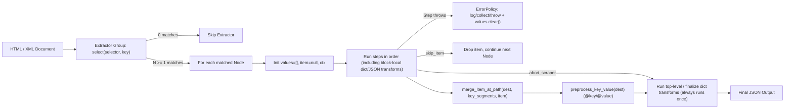

import { Aside } from '@astrojs/starlight/components';
import XselPlayground from '../../../components/XselPlayground.astro';

The **`xsel2`** DSL (`.dsl` files) is the declarative pipeline language for `xsel2`.

<Aside type="tip" title="Explore state flow interactively">
  Every block in the `xsel2` DSL (`.dsl`) maintains a working string list (`values`) and an output object (`dict`). Try editing the pipeline below to see how `js_block`, `parse_js`, and `jmespath` transform them in real time.
</Aside>

<XselPlayground compact initialPreset="js_digger" />

## Lexical & Grammar Specification

### Comments

Single-line (`#` or `//`) and multi-line (`/* ... */`) comments are stripped by the lexer (`src/scraper/dsl/lexer.cpp`):

```xsel2
# Hash single-line comment
// C++ style single-line comment
/* Multi-line
   block comment */
```

> **Caveat**: Block comments (`/* ... */`) do not nest. An unterminated `/*` runs to EOF without error.

### Variables (`let`) & String Interpolation

Top-level `let` statements bind any DSL value (string, int, float, bool, `null`, list, object, or enum identifier) to a variable name:

```xsel2
let title_sel = "h1.product-title";
let base_url = "https://example.com"
let keep_keys = ["title", "price"]
let schema_patch = {source: "web", active: true}
```

- Trailing `;` on `let` statements is optional.
- Variables are evaluated in top-to-bottom declaration order. Re-declaring `let x = ...` overwrites `x`.
- **String interpolation**: Inside any `"..."` or `'...'` string literal (including object keys and nested values), `${var}` substitutes `var.to_string()`.
  - Escape a literal `${...}` with `\${var}` (which renders as `${var}`).
  - **Caveats**:
    - Referencing an undefined variable in `${missing}` throws `std::runtime_error` at parse time.
    - Unterminated `${` throws `std::runtime_error`.
    - Interpolating a list or object produces `<list>` or `<object>` (because `DslValue::to_string()` is used). Pass list/object variables directly by identifier (e.g., `pick_keys(keep_keys)`), not inside `"${keep_keys}"`.
    - Passing an unquoted unknown identifier as an argument does **not** throw at parse time—it becomes a bare `Identifier` value (used for enum names or string coercion via `as_str()`).

### Scraper Declarations

A top-level scraper definition binds an identifier to a chain of pipeline steps:

```xsel2
# All four declaration styles are equivalent:
product = Scraper().select("h1").text().trim().set("title");
product: ScraperPy().select("h1").text().trim().set("title")
product := Scraper().select("h1").text().trim().set("title")
product = .select("h1").text().trim().set("title")
```

- The assignment operator may be `=`, `:`, `:=`, or even omitted before `Scraper()`/`ScraperPy()`.
- `Scraper(...)` / `ScraperPy(...)` constructor arguments, if any, are parsed and ignored.
- Trailing `;` is optional.
- Redefining the same scraper name overwrites the previous definition (`insert_or_assign`).
- **Implicit root extractor**: If a chain does not start with `select(...)` or `$`, the first non-`select` step implicitly creates an `Extractor` targeting the document root (`select("")`).

### Literals, Containers & Enums

| Type | Syntax Examples | Notes & Caveats |
| --- | --- | --- |
| **String** | `"hello"`, `'hello'` | Supports `\n`, `\t`, `\r`, `\$`, `\\`, `\"`, `\'` (any `\x` other than `n`/`t`/`r`/`$` yields `x`). Unterminated string throws. |
| **Integer** | `0`, `42`, `-1` | Parsed as 32-bit signed `int` (`std::from_chars`). |
| **Float** | `1.5`, `-0.25`, `1e5`, `2.5e-3` | Parsed as IEEE-754 `double`. Non-finite values (`inf`, `nan`) throw. |
| **Boolean** | `true`, `false` | Case-sensitive lowercase keywords. |
| **Null** | `null` | Mapped to `std::monostate` (or JSON `null`). |
| **List** | `["a", "b", 1]`, `["a",]` | Trailing comma before `]` is allowed. |
| **Object** | `{"old": "new", count: 1,}` | Keys can be quoted strings (with `${var}` interpolation) or bare identifiers. Trailing comma before `}` is allowed. |
| **Value enum** | `Value.Text`, `Text`, `text` | See mapping below. |

**`Value` enum accepted spellings** (case-sensitive):
- `Value.Text` | `Text` | `text` → extracts full subtree text (`node.Text()`)
- `Value.OwnText` | `OwnText` | `own_text` → extracts direct text children only (`node.OwnText()`)
- `Value.Attribute` | `Attribute` | `attr` → extracts attribute `attr` (`node.Attribute(attr)`)
- `Value.ElementExists` | `ElementExists` | `exists` → `"true"` if matched, `"false"` if empty
- `Value.AttributeExists` | `AttributeExists` | `attr_exists` → `"true"` if matched and has `attr`, `"false"` otherwise
- `Value.Adjacent` | `Adjacent` | `adjacent` → searches `node.NextSiblings()` and extracts text

> **Nesting limit**: `MAX_DSL_DEPTH = 256` applies to nested lists/objects, grouped `.( ... )` chains, and `{ ... }` blocks. Exceeding 256 throws `std::runtime_error`.

### Arguments: Positional vs. Keyword

Every step accepts positional arguments, keyword arguments (`name=value`), or a mix where **positional arguments come first**:

```xsel2
json_parse("cfg", allow_comments=true, allow_trailing_comma=true)
```

Strict validation rules (`src/scraper/dsl/value.cpp`):
1. **No positional after keyword**: `select("h1", key="a", "b")` throws.
2. **No duplicate keyword**: `select("h1", key="a", key="b")` throws.
3. **No dual positional + keyword**: passing the same parameter both positionally and by name throws.
4. **No extra positional or unknown keyword**: passing too many positional args or an unrecognized `kwarg=...` throws.
5. **Scalar list coercion**: steps expecting a string list (e.g., `filter`, `pick_keys`, `omit_keys`, `js_blocks`, `extract_many`, `merge_keys`, `strip_query`) accept either `["a", "b"]` or a single scalar `"a"` (automatically wrapped into `["a"]`).
6. **JSON document arguments**: steps expecting a JSON document (`json_schema`, `cast_keys`, `replace({...})`) accept either a DSL object/list literal (`{...}` / `[...]`) **or** a JSON string literal (`'{"a": 1}'`).

---

## Execution, State & Merge Model

### Pipeline Architecture



### Per-Node State: `values` vs. `dict`

Inside each `Extractor` match, two mutable state objects exist (alongside a per-node `ExecutionContext` holding `save`/`restore` slots and `skip_item`/`abort_scraper` guard flags):
1. **`values`** (`std::vector<std::string>`): The working list of extracted/transformed strings.
   - Extraction steps (`text`, `attr`, `html`, `outer_html`, `tag_name`, `classes`, `find`, `find_all`, `xpath`, `xpath3`) **append** to `values`.
   - Transform steps (`trim`, `squish`, `lower`, `upper`, `replace`, `regex_replace`, `prepend`, `append`, `substring`, `unescape`, `unescape_html`, `strip_comments`, `strip_tags`, `base64_*`, `hash`, `slugify`, `resolve_url`, `url_part`, `query_param`, `strip_query`, `unicode_normalize`, `strip_accents`, `map_values`) mutate `values` **in place**.
   - Filtering/slicing steps (`drop_empty`, `regex_filter`, `filter`, `filter_urls`, `fuzzy_filter`, `first`, `last`, `nth`, `slice`, `unique`, `sort`, `reverse`, `default`) prune, reorder, or fallback `values`.
   - Expansion/reduction steps (`split`, `join`, `regex_extract`, `regex_find_all`, `extract_many`, `js_block`, `parse_srcset`, `css_url`) replace `values` with a new vector.
   - **Strict Sink Rule (writing to `dict` clears `values`)**: Every step that reads `values` and writes to `dict` **clears `values`**—use `tee { ... }` if you need to keep `values` for another step:
     - Always write to `dict` and clear `values`: `set`, `append_to`, `count`, `js_blocks`, `parse_js`, `json_parse`, `csv_parse`, `regex_groups`, `query_params`.
     - Dual-mode steps (`parse_number`, `parse_duration`, `to_int`, `to_float`, `to_bool`, `similarity`, `table`, `parse_date`): when `key == ""`, transform `values` in place (or push serialized JSON for `table`); when `key != ""`, write native JSON values to `dict[key]` and **clear `values`**.
   - Direct DOM-to-`dict` steps (write to `dict` without reading or modifying `values`): `attrs`, `extract_meta`, `extract_fields` (`fields`), `each` / nested `select(...) { ... }`.
2. **`dict`** (`jsoncons::json`, initially `null`): The local JSON object for the current matched node.

> **Important**: If a top-level extractor's `select(selector)` matches **0 nodes**, its block-local steps do not run. However, top-level dict/JSON transforms (placed outside `{ ... }` blocks) and `finalize { ... }` blocks **always** run once after all extractors finish.

### Block-Local vs. Document-Level Execution

All dictionary and JSON transformation steps (`flatten`, `pick_keys`, `omit_keys`, `rename_keys`, `merge_keys`, `sort_array`, `deduplicate`, `jmespath`, `jsonpath`, `json_schema`, `cast_keys`, `zip_keys`, `coalesce_keys`) execute **immediately** without hidden deferral flags:

- **Inside `{ ... }` blocks or `.( ... )` grouped chains**: Each dict/JSON transform runs in-order on the current node's local `dict` (`dict = step.transform(dict)`).
- **At the top level of a scraper chain** (outside `{ ... }` and `.( ... )`) **or inside `finalize { ... }`**: Dict/JSON transforms are appended to `finalize_steps_`, so they execute **once on the final accumulated `dest` document** after all extractors finish—even if a preceding `select(...)` matched 0 nodes.

### Dot-Paths, Collision Modes & Merging

- **Dot-path keys**: Both `select(selector, key)` and `set(key)` / `insert_into_json` split `key` on `.` into nested objects (e.g., `"meta.author"` → `{"meta": {"author": ...}}`). Escape a literal dot with `\.` (e.g., `"a\\.b"` in DSL string → `a.b` as a single key).
  > [!NOTE]
  > Dot-path splitting applies to extractor target keys and `coalesce_keys` source candidates. Dict transformation steps like `pick_keys`, `omit_keys`, `rename_keys`, `cast_keys`, and `merge_keys` do **not** parse dot-paths (`"a.b"`). Instead, `pick_keys`, `omit_keys`, and `rename_keys` operate recursively matching bare key names across all nesting levels.
- **Empty value skipping**: By default (`allow_empty=false`), `insert_into_json` and `merge_into` ignore `null`, `""`, `[]`, and `{}` (`is_empty_json`).
- **Single vs. Multiple values in `set`**:
  - 0 non-whitespace values → nothing is written (unless `allow_empty=true` on `InsertOptions` in C++/Python).
  - 1 value → stored as a scalar.
  - 2+ values → stored as a JSON array.
- **Single vs. Multiple node matches in `select`**:
  - When `select` matches **1 node**, its `item` object is merged into `dest` (or `dest[key]`).
  - When `select` matches **multiple nodes** with overlapping keys (e.g. two `<div class="card">` elements both setting `"title"`), `merge_into` detects the common key and automatically combines the node objects into a **JSON array** (`[{title: ...}, {title: ...}]`).
  - If two extractors set **disjoint** keys on the root object, `merge_into` merges them into the same root object.
- **Key collision inside a single `dict` (`set` / `count`)**: Default `InsertMode::Default` uses `UniqueSuffix` (`key`, `key_0`, `key_1`, ...).

### `@key` / `@value` Post-Processing

`preprocess_key_value` runs during `merge_into` and once at the end of `Scraper::perform_extraction`:
- If any JSON object contains **both** `"@key"` and `"@value"`, those two fields are removed and replaced with `[json_to_string(@key)]: @value` (skipped if `@key` is empty or `@value` is empty).
- If an object contains only `"@key"` or only `"@value"`, the dangling `@key`/`@value` field is erased.
- This allows scraping dynamic key-value pairs (e.g. `dt`/`dd` or `th`/`td`) by setting `"@key"` and `"@value"` on each item!

### Error Policies & Recovery (`find(...)` + `??` vs. `required=true`)

`Extractor::extract` supports three `ErrorPolicy` modes (configured in CLI/Python/C++):
- `LogAndContinue` (**default**): Logs `[prefix] Extractor error (name): ...` to `stderr`, **clears `values`**, and continues to the next step.
- `CollectErrors`: Appends the error string to `errors()`, **clears `values`**, and continues.
- `ThrowOnError`: Rethrows immediately, aborting the extraction.

> **Idiom & Caveat**: `find` and `find_all` are optional by default (`required=false`), so `find(".x") ?? "N/A"` works cleanly for normal fallbacks without throwing or logging to `stderr`. Only pass `required=true` when you genuinely want missing fields flagged—for example, to abort under `ThrowOnError`, record an error under `CollectErrors`, or log `[prefix] Extractor error (name): ...` to `stderr` under `LogAndContinue` (which also clears `values` so a subsequent `?? "N/A"` can still recover).

---

## Engines, Limits & Caveats

| Engine / Library | Used By | Key Caveats & Limits |
| --- | --- | --- |
| **`lxml2-query` + `libxml2`** | `select`, `find`, `find_all`, `extract_fields`, `xpath`, `xpath3`, `resolve_url`, `url_part`, `query_param`, `query_params`, `strip_query`, `filter_urls`, `table`, `extract_meta`, `each`, `when_exists`, `unless_exists`, `skip_if_exists`, `abort_if_exists` | `libxml2` HTML parser is lenient; CSS selectors support standard CSS3 (`>`, `+`, `~`, `[attr=val]`, `:nth-child`, etc.). `xpath` evaluates XPath 1.0 relative to the current node; `xpath3` evaluates XPath 3.1 via `lxml2-query` when `XSEL_USE_XPATH3=ON` (default). `query_params` and `strip_query` also tolerate unencoded `[` / `]` in query strings. |
| **RE2** | `regex_replace` (`sub`), `regex_filter` (`grep`), `regex_extract` (`extract`), `regex_find_all`, `regex_groups`, `when_match`, `css_url` | Linear-time, guaranteed no catastrophic backtracking (no lookahead/lookbehind/backreferences). **Default is case-sensitive** (`flags=null`/`""`); pass `"icase"` or `"i"` for case-insensitive matching, `"dotall"` or `"s"` for `.` matching `\n`, and `"multiline"` or `"m"` for line-anchored `^`/`$`. |
| **Compressed-DFA Aho-Corasick** | `filter`, `replace({...})`, `extract_many` | Single-pass $O(n + m)$ literal matching. Mapping-mode `replace({old: new})` resolves overlapping matches by leftmost-longest. |
| **Heuristic JS/JSON Digger** | `js_block`, `js_blocks`, `parse_js`, `json_parse(..., lenient=true)` | Does **not** execute JavaScript; heuristically extracts object/array literals, strips `//` and `/* */` comments, folds `+`-joined strings, expands `JSON.parse("...")`, and maps `undefined` → `null`. |
| **`jsoncons`** | `jmespath`, `jsonpath`, `json_schema`, `json_parse`, `json_dump`, `csv_*` | `MAX_JSON_DEPTH = 512` in `xsel::common`; `json_parse` defaults `max_nesting_depth = 1024`. |
| **`absl::Time`** | `parse_date` | Auto-detects 15 common ISO/RFC/web date formats or uses explicit `strftime` `fmt`. Timezone names use IANA tzdb (e.g. `"America/Sao_Paulo"`, `"UTC"`). |
| **`utf8proc`** | `unicode_normalize`, `strip_accents` | Full Unicode `NFC`/`NFD`/`NFKC`/`NFKD` and combining mark (`Mn`) stripping. |
| **Fuzzy (`xsel::common`)** | `fuzzy_filter`, `similarity` | UTF-8 codepoint-aware `jaro_winkler` (`jw`) and `levenshtein` (`lev`, `edit`). **Caveat**: `case_sensitive=false` folds ASCII `A-Z` to `a-z` only (not full Unicode case folding). |

---

## Running & Embedding DSL

- **CLI (`xsel2`)**:
  ```bash
  ./build/xsel2 -d examples/product.dsl -n product --html page.html
  cat page.html | ./build/xsel2 -d examples/product.dsl -n product -c
  ./build/xsel2 -d examples/product.dsl -n product --batch pages/*.html -j 0
  ```
  See [CLI Reference](/xsel2/cli/).
- **Python (`scraperpy`)**:
  ```python
  import scraperpy
  scrapers = scraperpy.parse_dsl_string(dsl_text) # or load_scrapers("examples/product.dsl")
  result = scrapers["product"].from_string(html)
  ```
  Every DSL method maps 1:1 to a `ScraperPy` method. See [Python Bindings](/xsel2/python/).
- **C++20 (`scraper::dsl::DslParser`)**:
  ```cpp
  scraper::dsl::DslParser parser;
  auto scrapers = parser.parse_file("examples/product.dsl");
  jsoncons::json out = scrapers.at("product").scrape_from_string(html);
  ```
  In C++ `ScraperBuilder`, method names use `PascalCase` (e.g., `select` → `Select`, `regex_extract` → `RegexExtract`, `json_parse` → `JsonParse`). See [C++20 API Guide](/xsel2/cpp-api/).

---

