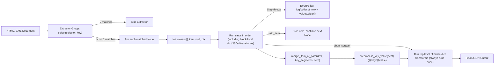

# DSL & Pipeline Steps Manual

The `xsel2` DSL (`.dsl`) is a declarative, fluent pipeline language for HTML/XML scraping, multi-pattern text extraction, and JSON/CSV transformation. It compiles directly into `scraper::ScraperBuilder` pipelines and runs identically from the `xsel2` CLI, Python (`scraperpy`), and C++ (`scraper::dsl::DslParser`).

This manual documents **100%** of the DSL grammar, syntax sugar, execution & merge engine, pipeline composition (`pipe`/`use`/`include`/`finalize`/`tee`/`each`/`when_*`), all canonical pipeline steps and aliases, and every known caveat or edge case.

---

## Table of Contents

- [1. Lexical & Grammar Specification](#1-lexical--grammar-specification)
  - [Comments](#comments)
  - [Variables (`let`) & String Interpolation](#variables-let--string-interpolation)
  - [Scraper Declarations](#scraper-declarations)
  - [Literals, Containers & Enums](#literals-containers--enums)
  - [Arguments: Positional vs. Keyword](#arguments-positional-vs-keyword)
- [2. Syntax Sugar & Aliases](#2-syntax-sugar--aliases)
  - [Chaining & Grouping](#chaining--grouping)
  - [Shorthand Operators](#shorthand-operators)
  - [Complete Alias Table (17 Aliases)](#complete-alias-table-17-aliases)
  - [Composition, Branching & Control Flow](#composition-branching--control-flow)
- [3. Execution, State & Merge Model](#3-execution-state--merge-model)
  - [Pipeline Architecture](#pipeline-architecture)
  - [Per-Node State: `values` vs. `dict`](#per-node-state-values-vs-dict)
  - [Block-Local vs. Document-Level Execution](#block-local-vs-document-level-execution)
  - [Dot-Paths, Collision Modes & Merging](#dot-paths-collision-modes--merging)
  - [`@key` / `@value` Post-Processing](#key--value-post-processing)
  - [Error Policies & Recovery (`find(...)` + `??` vs. `required=true`)](#error-policies--recovery-find--vs-requiredtrue)
- [4. Engines, Limits & Caveats](#4-engines-limits--caveats)
- [5. Running & Embedding DSL](#5-running--embedding-dsl)
- [6. Pipeline Steps Reference](#6-pipeline-steps-reference)
  - [6.1 DOM & Selection](#61-dom--selection)
  - [6.2 Text Normalization & Manipulation](#62-text-normalization--manipulation)
  - [6.3 URL & Web Normalization](#63-url--web-normalization)
  - [6.4 Regex, Aho-Corasick & Filtering](#64-regex-aho-corasick--filtering)
  - [6.5 Slicing, Ordering & Fallbacks](#65-slicing-ordering--fallbacks)
  - [6.6 JS / JSON Block Digger](#66-js--json-block-digger)
  - [6.7 Dictionary, Typed Casting, JSON/CSV & Query Steps](#67-dictionary-typed-casting-jsoncsv--query-steps)
  - [6.8 XPath, Tables, Metadata, Dates, Unicode & Fuzzy Matching](#68-xpath-tables-metadata-dates-unicode--fuzzy-matching)
  - [6.9 Debugging](#69-debugging)
  - [6.10 Control Flow, Branching, Slots & Composition](#610-control-flow-branching-slots--composition)

---

## 1. Lexical & Grammar Specification

### Comments

Single-line (`#` or `//`) and multi-line (`/* ... */`) comments are stripped by the lexer (`src/scraper/dsl/lexer.cpp`):

```text
# Hash single-line comment
// C++ style single-line comment
/* Multi-line
   block comment */
```

> **Caveat**: Block comments (`/* ... */`) do not nest. An unterminated `/*` runs to EOF without error.

### Variables (`let`) & String Interpolation

Top-level `let` statements bind any DSL value (string, int, float, bool, `null`, list, object, or enum identifier) to a variable name:

```text
let title_sel = "h1.product-title";
let base_url = "https://example.com"
let keep_keys = ["title", "price"]
let schema_patch = {source: "web", active: true}
```

- Trailing `;` on `let` statements is optional.
- Variables are evaluated in top-to-bottom declaration order. Re-declaring `let x = ...` overwrites `x`.
- **String interpolation**: Inside any `"..."` or `'...'` string literal (including object keys and nested values), `${var}` substitutes `var.to_string()`.
  - Escape a literal `${...}` with `\${var}` (which renders as `${var}`).
  - **Caveats**:
    - Referencing an undefined variable in `${missing}` throws `std::runtime_error` at parse time.
    - Unterminated `${` throws `std::runtime_error`.
    - Interpolating a list or object produces `<list>` or `<object>` (because `DslValue::to_string()` is used). Pass list/object variables directly by identifier (e.g., `pick_keys(keep_keys)`), not inside `"${keep_keys}"`.
    - Passing an unquoted unknown identifier as an argument does **not** throw at parse time—it becomes a bare `Identifier` value (used for enum names or string coercion via `as_str()`).

### Scraper Declarations

A top-level scraper definition binds an identifier to a chain of pipeline steps:

```text
# All four declaration styles are equivalent:
product = Scraper().select("h1").text().trim().set("title");
product: ScraperPy().select("h1").text().trim().set("title")
product := Scraper().select("h1").text().trim().set("title")
product = .select("h1").text().trim().set("title")
```

- The assignment operator may be `=`, `:`, `:=`, or even omitted before `Scraper()`/`ScraperPy()`.
- `Scraper(...)` / `ScraperPy(...)` constructor arguments, if any, are parsed and ignored.
- Trailing `;` is optional.
- Redefining the same scraper name overwrites the previous definition (`insert_or_assign`).
- **Implicit root extractor**: If a chain does not start with `select(...)` or `$`, the first non-`select` step implicitly creates an `Extractor` targeting the document root (`select("")`).

### Literals, Containers & Enums

| Type | Syntax Examples | Notes & Caveats |
| --- | --- | --- |
| **String** | `"hello"`, `'hello'` | Supports `\n`, `\t`, `\r`, `\$`, `\\`, `\"`, `\'` (any `\x` other than `n`/`t`/`r`/`$` yields `x`). Unterminated string throws. |
| **Integer** | `0`, `42`, `-1` | Parsed as 32-bit signed `int` (`std::from_chars`). |
| **Float** | `1.5`, `-0.25`, `1e5`, `2.5e-3` | Parsed as IEEE-754 `double`. Non-finite values (`inf`, `nan`) throw. |
| **Boolean** | `true`, `false` | Case-sensitive lowercase keywords. |
| **Null** | `null` | Mapped to `std::monostate` (or JSON `null`). |
| **List** | `["a", "b", 1]`, `["a",]` | Trailing comma before `]` is allowed. |
| **Object** | `{"old": "new", count: 1,}` | Keys can be quoted strings (with `${var}` interpolation) or bare identifiers. Trailing comma before `}` is allowed. |
| **Value enum** | `Value.Text`, `Text`, `text` | See mapping below. |

**`Value` enum accepted spellings** (case-sensitive):
- `Value.Text` | `Text` | `text` → extracts full subtree text (`node.Text()`)
- `Value.OwnText` | `OwnText` | `own_text` → extracts direct text children only (`node.OwnText()`)
- `Value.Attribute` | `Attribute` | `attr` → extracts attribute `attr` (`node.Attribute(attr)`)
- `Value.ElementExists` | `ElementExists` | `exists` → `"true"` if matched, `"false"` if empty
- `Value.AttributeExists` | `AttributeExists` | `attr_exists` → `"true"` if matched and has `attr`, `"false"` otherwise
- `Value.Adjacent` | `Adjacent` | `adjacent` → searches `node.NextSiblings()` and extracts text

> **Nesting limit**: `MAX_DSL_DEPTH = 256` applies to nested lists/objects, grouped `.( ... )` chains, and `{ ... }` blocks. Exceeding 256 throws `std::runtime_error`.

### Arguments: Positional vs. Keyword

Every step accepts positional arguments, keyword arguments (`name=value`), or a mix where **positional arguments come first**:

```text
json_parse("cfg", allow_comments=true, allow_trailing_comma=true)
```

Strict validation rules (`src/scraper/dsl/value.cpp`):
1. **No positional after keyword**: `select("h1", key="a", "b")` throws.
2. **No duplicate keyword**: `select("h1", key="a", key="b")` throws.
3. **No dual positional + keyword**: passing the same parameter both positionally and by name throws.
4. **No extra positional or unknown keyword**: passing too many positional args or an unrecognized `kwarg=...` throws.
5. **Scalar list coercion**: steps expecting a string list (e.g., `filter`, `pick_keys`, `omit_keys`, `js_blocks`, `extract_many`, `merge_keys`, `strip_query`) accept either `["a", "b"]` or a single scalar `"a"` (automatically wrapped into `["a"]`).
6. **JSON document arguments**: steps expecting a JSON document (`json_schema`, `cast_keys`, `replace({...})`) accept either a DSL object/list literal (`{...}` / `[...]`) **or** a JSON string literal (`'{"a": 1}'`).

---

## 2. Syntax Sugar & Aliases

### Chaining & Grouping

- **Chain separators**: `.`, `|`, and `|>` are completely interchangeable:
  ```text
  s = Scraper().select("h1") | text() |> trim() -> "title"
  ```
- **Paren-free zero-arg steps**: Omit `()` when calling any step with zero arguments (or relying on all defaults):
  ```text
  $("h1") { text | clean | lower -> "title" }
  ```
- **Grouped sub-chains `.( ... )`**: Visually group related steps in a chain (e.g., `.(.find(...).trim().set("x"))` or `| (.text | .trim)`).
- **Select blocks `select(...) { ... }` and `$(...) { ... }`**:
  - Top-level `select(...)` or `$` queries from the document root and optionally accepts a `{ ... }` block.
  - Inside `{ ... }`, the leading `.`, `|`, or `|>` before the very first step is optional.
  - **Lexical scoping inside `{ ... }`**: A `select(...)` or `$(...)` written *inside* another `{ ... }` block **requires** a trailing `{ ... }` body and compiles to `each(...)`, querying **relative to the current node** (matching the key-scoping of `each(selector, key="") { ... }`).

### Shorthand Operators

| Shorthand | Equivalent Canonical Call | Notes & Caveats |
| --- | --- | --- |
| `$("sel")` or `$ "sel"` | `select("sel")` | Supports `{ ... }` block immediately after. `$("sel", "key")` also works. |
| `@href`, `@"href"`, `@("href")`, `@["data-src", "src"]` | `attr(...)` | `@ident` parses `ident` as attribute name; list form tries fallback attributes in order. |
| `?? "fallback"` | `default("fallback")` | Coerces argument via `as_str()`. |
| `[i]` (e.g. `[0]`, `[2]`) | `nth(i)` | Non-negative integer index. |
| `[-1]` | `last(1)` | **Caveat**: Any negative index other than `-1` (e.g., `[-2]`) throws at parse time. |
| `-> "key"`, `>> "key"`, `as "key"` | `set("key")` | Always uses default `type="string"`. For typed `set`, call `set("key", "int")` or `as("key", "int")`. |

### Complete Alias Table (17 Aliases)

| Alias | Canonical Step | Notes |
| --- | --- | --- |
| `strip` | `trim` | Strips leading/trailing ASCII whitespace |
| `clean` | `squish` | Trims and collapses internal whitespace runs |
| `normalize_whitespace` | `squish` | Long alias for `squish` |
| `sub` | `regex_replace` | RE2 global regex replacement |
| `grep` | `regex_filter` | RE2 regex filter |
| `extract` | `regex_extract` | RE2 regex capture extraction |
| `as` | `set` | Both `as "k"` (sugar) and `as("k", "int")` (alias) work |
| `limit` | `first` | Keeps first `count` items |
| `dedup` | `unique` | Removes duplicate items |
| `extract_js_block` | `js_block` | Locates balanced `{...}` / `[...]` / `(...)` block |
| `extract_js_blocks` | `js_blocks` | Extracts & parses multiple prefixed JS blocks into `dict` |
| `json` | `json_parse` | Supports all `json_parse` kwargs including `lenient=true` |
| `to_number` | `parse_number` | Extracts/normalizes numeric strings |
| `url_join` | `resolve_url` | RFC 3986 relative URL resolution |
| `inner_html` | `html` | Extracts inner (or outer if `outer=true`) HTML |
| `fields` | `extract_fields` | Single-pass multi-selector extraction into `dict` |
| `branch` | `tee` | Runs sub-chain on a copy of `values` |

### Composition, Branching & Control Flow

- **Reusable pipeline fragments (`pipe` + `use`)**:
  ```text
  pipe link_map = { text | squish -> "@key" | @href | squish -> "@value" };
  s := Scraper().select(".links a", "links") { use(link_map) };
  ```
- **Scraper composition (`include`)**: Appends all extractors and `finalize` steps from a previously declared scraper (`Scraper().include(base)`).
- **Value branching (`tee { ... }` / `branch { ... }`) & slots (`save` / `restore`)**:
  - `tee { ... }` executes its block on a copy of `values` while sharing `dict`, leaving the outer `values` intact.
  - `save("slot")` / `restore("slot")` store and recall `values` within the current matched node's `ExecutionContext`.
- **Nested relative sub-extractors (`each(selector, key="") { ... }`)**: Queries relative to the current matched node (arbitrarily nestable), supporting `@key`/`@value` collapsing.
- **Conditional blocks & guards**:
  - `when_exists(selector) { ... }`, `unless_exists(selector) { ... }`, `when_match(pattern, negate=false, flags=null) { ... }`: conditionally run steps on the shared `values` and `dict`.
  - `skip_if_exists(selector)`, `skip_if_empty()`: drop the current item before merging into `dest`.
  - `abort_if_exists(selector, key="", reason="")`: optionally record `reason` (or `true`) under `key` and stop subsequent extractors immediately.
- **Scraper-level post-processing (`finalize { ... }`)**: Always runs once after all extractors finish (even if the final `select(...)` matched 0 nodes).

See [Section 6.10](#610-control-flow-branching-slots--composition) for full signatures, caveats, and examples of every control-flow and composition step.

---

## 3. Execution, State & Merge Model

### Pipeline Architecture



### Per-Node State: `values` vs. `dict`

Inside each `Extractor` match, two mutable state objects exist (alongside a per-node `ExecutionContext` holding `save`/`restore` slots and `skip_item`/`abort_scraper` guard flags):
1. **`values`** (`std::vector<std::string>`): The working list of extracted/transformed strings.
   - Extraction steps (`text`, `attr`, `html`, `outer_html`, `tag_name`, `classes`, `find`, `find_all`, `xpath`) **append** to `values`.
   - Transform steps (`trim`, `squish`, `lower`, `upper`, `replace`, `regex_replace`, `prepend`, `append`, `substring`, `unescape`, `unescape_html`, `strip_comments`, `strip_tags`, `base64_*`, `hash`, `slugify`, `resolve_url`, `url_part`, `query_param`, `strip_query`, `unicode_normalize`, `strip_accents`, `map_values`) mutate `values` **in place**.
   - Filtering/slicing steps (`drop_empty`, `regex_filter`, `filter`, `filter_urls`, `fuzzy_filter`, `first`, `last`, `nth`, `slice`, `unique`, `sort`, `reverse`, `default`) prune, reorder, or fallback `values`.
   - Expansion/reduction steps (`split`, `join`, `regex_extract`, `regex_find_all`, `extract_many`, `js_block`, `parse_srcset`, `css_url`) replace `values` with a new vector.
   - **Strict Sink Rule (writing to `dict` clears `values`)**: Every step that reads `values` and writes to `dict` **clears `values`**—use `tee { ... }` if you need to keep `values` for another step:
     - Always write to `dict` and clear `values`: `set`, `append_to`, `count`, `js_blocks`, `parse_js`, `json_parse`, `csv_parse`, `regex_groups`, `query_params`.
     - Dual-mode steps (`parse_number`, `parse_duration`, `to_int`, `to_float`, `to_bool`, `similarity`, `table`, `parse_date`): when `key == ""`, transform `values` in place (or push serialized JSON for `table`); when `key != ""`, write native JSON values to `dict[key]` and **clear `values`**.
   - Direct DOM-to-`dict` steps (write to `dict` without reading or modifying `values`): `attrs`, `extract_meta`, `extract_fields` (`fields`), `each` / nested `select(...) { ... }`.
2. **`dict`** (`jsoncons::json`, initially `null`): The local JSON object for the current matched node.

> **Important**: If a top-level extractor's `select(selector)` matches **0 nodes**, its block-local steps do not run. However, top-level dict/JSON transforms (placed outside `{ ... }` blocks) and `finalize { ... }` blocks **always** run once after all extractors finish.

### Block-Local vs. Document-Level Execution

All dictionary and JSON transformation steps (`flatten`, `pick_keys`, `omit_keys`, `rename_keys`, `merge_keys`, `sort_array`, `deduplicate`, `jmespath`, `jsonpath`, `json_schema`, `cast_keys`, `zip_keys`, `coalesce_keys`) execute **immediately** without hidden deferral flags:

- **Inside `{ ... }` blocks or `.( ... )` grouped chains**: Each dict/JSON transform runs in-order on the current node's local `dict` (`dict = step.transform(dict)`).
- **At the top level of a scraper chain** (outside `{ ... }` and `.( ... )`) **or inside `finalize { ... }`**: Dict/JSON transforms are appended to `finalize_steps_`, so they execute **once on the final accumulated `dest` document** after all extractors finish—even if a preceding `select(...)` matched 0 nodes.

### Dot-Paths, Collision Modes & Merging

- **Dot-path keys**: Both `select(selector, key)` and `set(key)` / `insert_into_json` split `key` on `.` into nested objects (e.g., `"meta.author"` → `{"meta": {"author": ...}}`). Escape a literal dot with `\.` (e.g., `"a\\.b"` in DSL string → `a.b` as a single key).
- **Empty value skipping**: By default (`allow_empty=false`), `insert_into_json` and `merge_into` ignore `null`, `""`, `[]`, and `{}` (`is_empty_json`).
- **Single vs. Multiple values in `set`**:
  - 0 non-whitespace values → nothing is written (unless `allow_empty=true` on `InsertOptions` in C++/Python).
  - 1 value → stored as a scalar.
  - 2+ values → stored as a JSON array.
- **Single vs. Multiple node matches in `select`**:
  - When `select` matches **1 node**, its `item` object is merged into `dest` (or `dest[key]`).
  - When `select` matches **multiple nodes** with overlapping keys (e.g. two `<div class="card">` elements both setting `"title"`), `merge_into` detects the common key and automatically combines the node objects into a **JSON array** (`[{title: ...}, {title: ...}]`).
  - If two extractors set **disjoint** keys on the root object, `merge_into` merges them into the same root object.
- **Key collision inside a single `dict` (`set` / `count`)**: Default `InsertMode::Default` uses `UniqueSuffix` (`key`, `key_0`, `key_1`, ...).

### `@key` / `@value` Post-Processing

`preprocess_key_value` runs during `merge_into` and once at the end of `Scraper::perform_extraction`:
- If any JSON object contains **both** `"@key"` and `"@value"`, those two fields are removed and replaced with `[json_to_string(@key)]: @value` (skipped if `@key` is empty or `@value` is empty).
- If an object contains only `"@key"` or only `"@value"`, the dangling `@key`/`@value` field is erased.
- This allows scraping dynamic key-value pairs (e.g. `dt`/`dd` or `th`/`td`) by setting `"@key"` and `"@value"` on each item!

### Error Policies & Recovery (`find(...)` + `??` vs. `required=true`)

`Extractor::extract` supports three `ErrorPolicy` modes (configured in CLI/Python/C++):
- `LogAndContinue` (**default**): Logs `[prefix] Extractor error (name): ...` to `stderr`, **clears `values`**, and continues to the next step.
- `CollectErrors`: Appends the error string to `errors()`, **clears `values`**, and continues.
- `ThrowOnError`: Rethrows immediately, aborting the extraction.

> **Idiom & Caveat**: `find` and `find_all` are optional by default (`required=false`), so `find(".x") ?? "N/A"` works cleanly for normal fallbacks without throwing or logging to `stderr`. Only pass `required=true` when you genuinely want missing fields flagged—for example, to abort under `ThrowOnError`, record an error under `CollectErrors`, or log `[prefix] Extractor error (name): ...` to `stderr` under `LogAndContinue` (which also clears `values` so a subsequent `?? "N/A"` can still recover).

---

## 4. Engines, Limits & Caveats

| Engine / Library | Used By | Key Caveats & Limits |
| --- | --- | --- |
| **`lxml2-query` + `libxml2`** | `select`, `find`, `find_all`, `extract_fields`, `xpath`, `resolve_url`, `url_part`, `query_param`, `query_params`, `strip_query`, `filter_urls`, `table`, `extract_meta`, `each`, `when_exists`, `unless_exists`, `skip_if_exists`, `abort_if_exists` | `libxml2` HTML parser is lenient; CSS selectors support standard CSS3 (`>`, `+`, `~`, `[attr=val]`, `:nth-child`, etc.). `xpath` evaluates XPath 1.0 relative to the current node. `query_params` and `strip_query` also tolerate unencoded `[` / `]` in query strings. |
| **RE2** | `regex_replace` (`sub`), `regex_filter` (`grep`), `regex_extract` (`extract`), `regex_find_all`, `regex_groups`, `when_match`, `css_url` | Linear-time, guaranteed no catastrophic backtracking (no lookahead/lookbehind/backreferences). **Default is case-sensitive** (`flags=null`/`""`); pass `"icase"` or `"i"` for case-insensitive matching, `"dotall"` or `"s"` for `.` matching `\n`, and `"multiline"` or `"m"` for line-anchored `^`/`$`. |
| **Compressed-DFA Aho-Corasick** | `filter`, `replace({...})`, `extract_many` | Single-pass $O(n + m)$ literal matching. Mapping-mode `replace({old: new})` resolves overlapping matches by leftmost-longest. |
| **Heuristic JS/JSON Digger** | `js_block`, `js_blocks`, `parse_js`, `json_parse(..., lenient=true)` | Does **not** execute JavaScript; heuristically extracts object/array literals, strips `//` and `/* */` comments, folds `+`-joined strings, expands `JSON.parse("...")`, and maps `undefined` → `null`. |
| **`jsoncons`** | `jmespath`, `jsonpath`, `json_schema`, `json_parse`, `json_dump`, `csv_*` | `MAX_JSON_DEPTH = 512` in `xsel::common`; `json_parse` defaults `max_nesting_depth = 1024`. |
| **`absl::Time`** | `parse_date` | Auto-detects 15 common ISO/RFC/web date formats or uses explicit `strftime` `fmt`. Timezone names use IANA tzdb (e.g. `"America/Sao_Paulo"`, `"UTC"`). |
| **`utf8proc`** | `unicode_normalize`, `strip_accents` | Full Unicode `NFC`/`NFD`/`NFKC`/`NFKD` and combining mark (`Mn`) stripping. |
| **Fuzzy (`xsel::common`)** | `fuzzy_filter`, `similarity` | UTF-8 codepoint-aware `jaro_winkler` (`jw`) and `levenshtein` (`lev`, `edit`). **Caveat**: `case_sensitive=false` folds ASCII `A-Z` to `a-z` only (not full Unicode case folding). |

---

## 5. Running & Embedding DSL

- **CLI (`xsel2`)**:
  ```bash
  ./build/xsel2 -d examples/product.dsl -n product --html page.html
  cat page.html | ./build/xsel2 -d examples/product.dsl -n product -c
  ./build/xsel2 -d examples/product.dsl -n product --batch pages/*.html -j 0
  ```
  See [CLI Reference](cli.md).
- **Python (`scraperpy`)**:
  ```python
  import scraperpy
  scrapers = scraperpy.parse_dsl_string(dsl_text) # or load_scrapers("examples/product.dsl")
  result = scrapers["product"].from_string(html)
  ```
  Every DSL method maps 1:1 to a `ScraperPy` method. See [Python Bindings](python.md).
- **C++20 (`scraper::dsl::DslParser`)**:
  ```cpp
  scraper::dsl::DslParser parser;
  auto scrapers = parser.parse_file("examples/product.dsl");
  jsoncons::json out = scrapers.at("product").scrape_from_string(html);
  ```
  In C++ `ScraperBuilder`, method names use `PascalCase` (e.g., `select` → `Select`, `regex_extract` → `RegexExtract`, `json_parse` → `JsonParse`). See [C++20 API Guide](cpp-api.md).

---

## 6. Pipeline Steps Reference

### 6.1 DOM & Selection

| Step | Parameters & Defaults | Aliases / Sugar | Mutates |
| --- | --- | --- | --- |
| `select` | `(selector, key="")` | `$("...")`, `$ "..."`, `select(...) { ... }` | Top-level `Extractor`, or relative `each` inside `{ ... }` |
| `text` | `(own_text=false)` | — | Appends to `values` |
| `attr` | `(attr_name)` | `@attr`, `@"attr"`, `@("attr")`, `@[...]` | Appends to `values` |
| `find` | `(selector, type=Value.Text, attr="", squish=true, required=false)` | — | Appends first match to `values` |
| `find_all` | `(selector, type=Value.Text, attr="", squish=false, required=false)` | — | Appends all matches to `values` |
| `extract_fields` | `(spec, allow_empty=false)` | `fields` | Writes directly to `dict` |
| `html` | `(outer=false)` | `inner_html` | Appends to `values` |
| `outer_html` | `()` | — | Appends to `values` |
| `tag_name` | `()` | — | Appends to `values` |
| `classes` | `()` | — | Appends to `values` |
| `attrs` | `(data_only=false)` | — | Writes to `dict` |

#### `select(selector, key="")`
- **Sugar**: `$("sel")`, `$ "sel"`, `select("sel") { ... }`, `$("sel") { ... }`
- **Behavior**: Starts a new `Extractor` group on the `ScraperBuilder` at top level, or a relative nested `each(...)` extractor when placed inside `{ ... }`.
  - `selector` (`string`, required): CSS selector. Passing `""` targets the root node (at top level) or current node (inside `{ ... }`). Invalid CSS syntax throws `std::runtime_error` at parse time.
  - `key` (`string`, default `""`): Optional dot-path (e.g., `"product.items"`) under which this extractor's output is merged.
- **Caveats**:
  - At top level, `select` queries from the document root. If `selector` matches 0 nodes, that extractor is skipped (though subsequent top-level dict/JSON transforms and `finalize { ... }` still run).
  - Inside `{ ... }`, a nested `select(...) { ... }` or `$(...) { ... }` **requires** a `{ ... }` block and compiles to `each(...)`, querying **relative to the current node**.
- **Example**: `$("div.card", "cards") { find(".title") | trim -> "title" }`

#### `text(own_text=false)`
- **Behavior**: Extracts text from the current `Node` and appends it to `values`.
  - `own_text` (`bool`, default `false`): When `false`, extracts full recursive subtree text (`node.Text()`). When `true`, extracts only direct text-node children (`node.OwnText()`).
- **Caveats**: Appends `""` if `node` is invalid or has no text.
- **Example**: `$("p.summary") { text(own_text=true) | squish -> "summary" }`

#### `attr(attr_name)`
- **Sugar**: `@href`, `@"data-id"`, `@("data-id")`, `@["data-src", "src"]`
- **Behavior**: Extracts attribute `attr_name` (`string` or `list<string>`) from the current `Node` and appends it to `values`.
  - When `attr_name` is a single string, appends `node.Attribute(attr_name).value_or("")`.
  - When `attr_name` is a list of strings (fallback mode), checks each attribute name in order and appends the **first non-empty** attribute value (or `""` if none match).
- **Example**: `$("img.hero") { @["data-src", "src"] | resolve_url("https://shop.example") -> "hero_img" }`

#### `find(selector, type=Value.Text, attr="", squish=true, required=false)`
- **Parameters**:
  - `selector` (`string`, required): CSS selector matched via zero-allocation pre-order DFS from the current `Node` (or `NextSiblings()` when `type` is `Value.Adjacent`).
  - `type` (`Value` enum, optional): Defaults to `Value.Text`, or **automatically defaults to `Value.Attribute`** when `attr` is non-empty and `type` is omitted/`null`. Supports `Value.Text` (`Text`/`text`), `Value.OwnText` (`OwnText`/`own_text`), `Value.Attribute` (`Attribute`/`attr`), `Value.ElementExists` (`ElementExists`/`exists`), `Value.AttributeExists` (`AttributeExists`/`attr_exists`), and `Value.Adjacent` (`Adjacent`/`adjacent`).
  - `attr` (`string | list<string>`, default `""`): Attribute name or fallback list for `Value.Attribute` / `Value.AttributeExists`.
  - `squish` (`bool`, default `true`): Normalizes extracted whitespace inline (`TextNormalized` / `OwnTextNormalized` / `normalizeHtmlText`).
  - `required` (`bool`, default `false`): Optional by default (0 matches appends nothing and leaves existing `values` intact). When `true`, throws `std::runtime_error` if no match yields a non-empty value (ignored for `ElementExists` / `AttributeExists`, which always push `"true"`/`"false"`).
- **Behavior**: Stops traversal immediately upon finding the first matching descendant that produces a non-empty value and appends that single value to `values`.
- **Examples**:
  - `$("article") { find("h1") -> "title" }`
  - `$("article") { find("img.thumb", attr=["data-src", "src"]) -> "thumb" }`
  - `$("article") { find(".subtitle") ?? "N/A" -> "subtitle" }`

#### `find_all(selector, type=Value.Text, attr="", squish=false, required=false)`
- **Parameters**: Same as `find`, except `squish` defaults to `false`.
- **Behavior**: Evaluates `selector` relative to the current `Node` (or `NextSiblings()` when `type` is `Value.Adjacent`) and appends **every** matching non-empty value to `values` (or `"true"`/`"false"` for `ElementExists`/`AttributeExists`).
- **Caveats**: Optional by default (`required=false`); passing `required=true` makes 0 matches for non-existence types throw `std::runtime_error`.
- **Example**: `$("body") { find_all("a.tag") | trim -> "tags" }`

#### `extract_fields(spec, allow_empty=false)` / `fields`
- **Parameters**:
  - `spec` (`object`, required): Map of `{output_key: selector_string_or_field_spec}` where each value is either a CSS selector string (`"h1"`) or an options object `{sel|selector, type, attr, squish, trim, first, cast|as|to, default, join}`:
    - `sel` / `selector` (`string`, required): CSS selector.
    - `type` (`Value`, default `Value.Text`, or `Value.Attribute` automatically if `attr` is specified without `type`).
    - `attr` (`string | list<string>`): Attribute name or fallback list.
    - `squish` (`bool`, default `true`): Normalize whitespace runs.
    - `trim` (`bool`, default `false`): Trim leading/trailing ASCII whitespace when `squish=false`.
    - `first` (`bool`, default `true`): Stop after the first matching element (`true`) or collect all matches (`false`).
    - `cast` / `as` / `to` (`string`, default `"string"`): Type coercion (`"string"`, `"int"`, `"float"`, `"number"`, `"bool"`, `"auto"`).
    - `default` (any DSL/JSON value): Fallback written when no match is found.
    - `join` (`string`): Join multiple matches into a single string before coercing and writing.
  - `allow_empty` (`bool`, default `false`): Passed via `InsertOptions` when writing fields into `dict`.
- **Behavior**: Walks the current node's subtree once in a single pre-order traversal, retiring each `first=true` field as soon as it matches, and writes all extracted fields directly into `dict` (without modifying `values`).
- **Caveats**: For `ElementExists` and `AttributeExists`, writes native JSON booleans (`true`/`false`) unless `cast`/`as`/`to` is explicitly set.
- **Example**:
  ```text
  $("html") {
    fields({
      title: "h1",
      views: { sel: ".views", squish: true, cast: "int" },
      cover: { sel: "img.pic", attr: ["data-src", "src"] },
      has_badge: { sel: ".badge", type: exists }
    })
  }
  ```

#### `html(outer=false)` / `inner_html` & `outer_html()`
- **Behavior**: Serializes the current node's HTML via `libxml2` `htmlNodeDump` and appends it to `values`.
  - `html(outer=false)` (`inner_html` alias): dumps all child nodes (`outer=false`) or the node itself (`outer=true`).
  - `outer_html()`: canonical shorthand for `html(outer=true)`.
- **Example**: `$("div.rich") { inner_html -> "body_html" }`

#### `tag_name()`
- **Behavior**: Appends the current node's HTML/XML tag name (e.g., `"div"`, `"h1"`) to `values`.
- **Example**: `$("main > *") { tag_name -> "tag" }`

#### `classes()`
- **Behavior**: Splits the current node's `class` attribute and appends each CSS class name to `values`.
- **Example**: `$("button.primary") { classes -> "btn_classes" }`

#### `attrs(data_only=false)`
- **Behavior**: Writes all attributes of the current node directly into `dict` as string key/value pairs (does not modify `values`).
  - `data_only` (`bool`, default `false`): When `true`, writes only attributes whose name starts with `"data-"`.
- **Caveats**: Uses `insert_into_json` with default `InsertOptions` (`nested_path=true`, `UniqueSuffix` on collision).
- **Example**: `$("div.item") { attrs(data_only=true) }`

---

### 6.2 Text Normalization & Manipulation

All steps in this section operate in-place on `values` (except `split`, which expands `values`, and `join`, which collapses `values` to 1 item).

| Step | Parameters & Defaults | Aliases | Notes |
| --- | --- | --- | --- |
| `trim` | `()` | `strip` | Trims ASCII whitespace `" \t\n\r\f\v"` |
| `squish` | `()` | `clean`, `normalize_whitespace` | Trims & collapses whitespace runs |
| `lower` | `()` | — | Lowercases each value |
| `upper` | `()` | — | Uppercases each value |
| `unescape` | `(url_decode=true)` | — | Decodes `\n`, `\uXXXX`, and optional `%XX` |
| `replace` | `(from, to="", first_only=false)` or `(mapping)` | — | Replaces **all** occurrences by default (or single-pass AC via dict) |
| `split` | `(delimiter, keep_empty_parts=false)` | — | Splits each value into multiple items |
| `join` | `(delimiter)` | — | Joins all `values` into 1 string |
| `prepend` | `(prefix)` | — | Prepends `prefix` to each value |
| `append` | `(suffix)` | — | Appends `suffix` to each value |
| `drop_empty` | `(also_trim=true)` | — | Removes empty (or whitespace-only) items |
| `substring` | `(start_pos, length=null)` | — | Byte-indexed slice with negative support |
| `strip_comments` | `(multiline=true, single_line=true)` | — | Strips `/* ... */` and `// ...` |
| `strip_tags` | `()` | — | Strips `<...>` HTML/XML tags |
| `base64_encode` | `(urlsafe=false)` | — | Standard or URL-safe Base64 encode |
| `base64_decode` | `(urlsafe=false)` | — | Standard or URL-safe Base64 decode |
| `hash` | `(algo="fnv1a64")` | — | `"fnv1a64"` or `"sha256"` hex digest |
| `slugify` | `(separator="-", max_len=null)` | — | Lowercase ASCII URL slug |
| `map_values` | `(mapping, default_val=null)` | — | $O(1)$ exact-string lookup replacement |
| `unescape_html` | `()` | — | Decodes HTML entities to UTF-8 |
| `parse_srcset` | `(mode="largest")` | — | Picks `"largest"`/`"best"`, `"smallest"`, or `"all"` URLs |
| `css_url` | `()` | — | Extracts URLs from CSS `url(...)` declarations |

#### `trim()` / `strip`
- **Behavior**: Strips leading and trailing ASCII whitespace (`" \t\n\r\f\v"`) from each string in `values`.
- **Example**: `$("h1") { text | strip -> "title" }`

#### `squish()` / `clean` / `normalize_whitespace`
- **Behavior**: Strips leading/trailing whitespace and collapses internal whitespace runs into single spaces (`normalizeHtmlText`).
- **Example**: `$("p") { text | clean -> "body" }`

#### `lower()` & `upper()`
- **Behavior**: Converts each string in `values` to lowercase (`lower`) or uppercase (`upper`).
- **Example**: `$("span.code") { text | upper -> "code" }`

#### `unescape(url_decode=true)`
- **Behavior**: Decodes C/JSON backslash escapes (`\n`, `\r`, `\t`, `\b`, `\f`, `\\`, `\"`, `\'`, `\/`, `\uXXXX` including UTF-16 surrogate pairs) and, when `url_decode=true`, decodes `%XX` hex sequences.
- **Caveats**: Does **not** decode HTML entities like `&amp;` (those are already decoded by `libxml2` when extracting `text`/`attr`). Note `url_decode` does not convert `+` to space (unlike `query_param`).
- **Example**: `$("script") { text | unescape(url_decode=false) -> "raw" }`

#### `replace(from, to="", first_only=false)` / `replace(mapping)`
- **String mode (`from`, `to=""`, `first_only=false`)**: Replaces **all occurrences** of `from` with `to` in each string by default (`first_only=false`). Pass `first_only=true` to replace only the first occurrence. No-op if `from` is `""`.
- **Mapping mode (`mapping` or `{"old": "new", ...}` / JSON string)**: Simultaneous single-pass Aho-Corasick replacement across all keys in `mapping`. Overlapping matches resolve by leftmost-longest.
- **Examples**:
  - `$("span") { text | replace(",", "") -> "clean_num" }`
  - `$("p") { text | replace({"&": "and", "@": "at"}) -> "clean" }`

#### `split(delimiter, keep_empty_parts=false)`
- **Behavior**: Splits every string in `values` by `delimiter` (`string`, required, non-empty) and flattens all parts into `values`.
- **Caveats**: Passing `delimiter=""` throws `std::runtime_error` at parse/construction time.
- **Example**: `$("p.csv") { text | split(",") | trim -> "items" }`

#### `join(delimiter)`
- **Behavior**: Concatenates all strings in `values` into a single string separated by `delimiter` (`string`, required). No-op if `values` is empty.
- **Example**: `$("body") { find_all("li", Text) | join(" | ") -> "list_str" }`

#### `prepend(prefix)` & `append(suffix)`
- **Behavior**: Prepends `prefix` or appends `suffix` to every string in `values`.
- **Example**: `$("a") { @href | prepend("https://example.com") -> "url" }`

#### `drop_empty(also_trim=true)`
- **Behavior**: Removes empty strings from `values`. When `also_trim=true`, trims each string in-place first, so whitespace-only items are also dropped.
- **Example**: `$("body") { find_all("p", Text) | drop_empty -> "paragraphs" }`

#### `substring(start_pos, length=null)`
- **Behavior**: Extracts a byte-indexed substring from each string in `values`.
  - `start_pos` (`int`, required): Supports negative indices (counts from end of string; clamped to `0` if `-start_pos >= len`).
  - `length` (`int | null`, default `null`): When `null`, takes to end of string. When `> 0`, takes up to `length` bytes. When `== 0`, clears the string. When `< 0`, trims `abs(length)` bytes from the end of the string (Python-style slice end).
- **Caveat**: Operates on raw UTF-8 **bytes**, not Unicode codepoints.
- **Example**: `$("span.sku") { text | substring(4, -1) -> "sku_core" }`

#### `strip_comments(multiline=true, single_line=true)`
- **Behavior**: Strips `/* ... */` (`multiline=true`) and/or `// ...` (`single_line=true`) comments from each value while respecting quoted strings.
- **Example**: `$("script") { text | strip_comments -> "clean_js" }`

#### `strip_tags()`
- **Behavior**: Strips `<...>` HTML/XML tags from each string in `values`, respecting quoted attributes inside tags.
- **Example**: `$("div.raw") { html | strip_tags | clean -> "plain" }`

#### `base64_encode(urlsafe=false)` & `base64_decode(urlsafe=false)`
- **Behavior**: Encodes or decodes each string in `values` using standard Base64 (`urlsafe=false`) or URL-safe Base64 (`urlsafe=true`).
- **Caveats**: `base64_decode` throws `std::runtime_error` on invalid Base64 input.
- **Example**: `$("span.token") { text | base64_decode(urlsafe=true) -> "payload" }`

#### `hash(algo="fnv1a64")`
- **Behavior**: Replaces each string in `values` with its lowercase hex digest.
  - `algo`: `"fnv1a64"` / `"fnv1a"` (16 hex chars) or `"sha256"` / `"sha-256"` (64 hex chars). Unknown `algo` throws.
- **Example**: `$("h1") { text | hash("sha256") -> "title_hash" }`

#### `slugify(separator="-", max_len=null)`
- **Behavior**: Lowercases ASCII letters, keeps `[a-z0-9]`, replaces runs of other bytes with `separator`, strips leading/trailing `separator`, and optionally truncates to `max_len` (without leaving a trailing `separator`).
- **Caveat**: Non-ASCII characters are treated as separators; pair with `strip_accents()` first for accented Latin text!
- **Example**: `$("h1") { text | strip_accents | slugify(max_len=40) -> "slug" }`

#### `map_values(mapping, default_val=null)`
- **Parameters**:
  - `mapping` (`object | JSON string`, required): Exact-match string mapping `{old: new}`. Non-string values are coerced via `json_to_string`.
  - `default_val` (`string | null`, default `null`): Replacement string when a value is not in `mapping`. When `null`, unmatched values remain unchanged.
- **Behavior**: Performs an $O(1)$ hash-table lookup on each string in `values`.
- **Example**: `$(".status") { text | lower | map_values({"in stock": "available", "sold out": "unavailable"}, default_val="unknown") -> "status" }`

#### `unescape_html()`
- **Behavior**: Decodes named HTML entities (`&amp;`, `&lt;`, `&gt;`, `&quot;`, `&apos;`, `&nbsp;`, `&ndash;`, `&mdash;`, `&hellip;`, `&copy;`, `&reg;`, `&trade;`, `&laquo;`, `&raquo;`, `&lsquo;`, `&rsquo;`, `&ldquo;`, `&rdquo;`, `&bull;`, `&middot;`, `&euro;`, `&pound;`, `&yen;`, `&cent;`, `&times;`, `&divide;`, `&plusmn;`) and decimal/hex numeric character references (`&#NNN;`, `&#xHHH;`) to UTF-8 in `values`.
- **Caveat**: Unknown entities and invalid codepoints (`0`, surrogates, `> 0x10FFFF`) are preserved literally.
- **Example**: `$("script") { text | unescape_html -> "decoded" }`

#### `parse_srcset(mode="largest")`
- **Parameters**:
  - `mode` (`string`, default `"largest"`): `"largest"` (or `"best"`), `"smallest"`, or `"all"` (case-insensitive; unknown value throws `std::invalid_argument`).
- **Behavior**: Parses HTML `srcset` attributes (`url 2x`, `url 1080w`, or bare `url` weighted as `1.0`) and replaces `values` with the selected candidate URL(s). Drops items with no valid candidates.
- **Example**: `$("img.cover") { @srcset | parse_srcset("largest") -> "cover_hd" }`

#### `css_url()`
- **Behavior**: Runs a case-insensitive RE2 scan for `url(...)` declarations (double-quoted, single-quoted, or unquoted) across every string in `values` and replaces `values` with all extracted non-empty URLs.
- **Example**: `$("div.hero") { @style | css_url | first -> "bg_image" }`

---

### 6.3 URL & Web Normalization

URL steps process `values` (and `dict` for `query_params`) via `libxml2`'s RFC 3986 URI parser (`xmlBuildURI`, `xmlParseURI`, `xmlSaveUri`). `query_params`, `strip_query`, and `filter_urls` also include fallbacks for URLs with unencoded `[` or `]` in query strings.

| Step | Parameters & Defaults | Aliases | Notes |
| --- | --- | --- | --- |
| `resolve_url` | `(base_url)` | `url_join` | Resolves relative URLs against `base_url` |
| `url_part` | `(part)` | — | Extracts `scheme`, `host`, `port`, `path`, `query`, or `fragment` |
| `query_param` | `(name, default_val="")` | — | Extracts & URL-decodes query param (`+` → space) |
| `query_params` | `(mapping, default_val="")` | — | Multi-param query extraction into `dict`, clears `values` |
| `strip_query` | `(keep_params=[], drop_params=[])` | — | Strips all, non-whitelisted, or blacklisted query params (supports `*` globs) |
| `filter_urls` | `(allowed_domains=[], blocked_domains=[], allowed_schemes=["http", "https"], same_origin_of="")` | — | Filters `values` by scheme, domain suffix, and origin |

#### `resolve_url(base_url)` / `url_join`
- **Behavior**: Resolves each non-empty string in `values` against `base_url`. No-op if `base_url` is `""` or value is `""`.
- **Example**: `$("a") { @href | url_join("https://example.com/docs/") -> "url" }`

#### `url_part(part)`
- **Behavior**: Replaces each URL in `values` with the requested component (`"scheme"`, `"host"`, `"port"`, `"path"`, `"query"`, `"fragment"`, case-insensitive). Clears invalid URLs or missing parts to `""`. Unknown `part` throws at parse time.
- **Example**: `$("a") { @href | url_part("host") -> "domain" }`

#### `query_param(name, default_val="")`
- **Behavior**: Extracts the first query parameter matching `name` (after URL-decoding keys and values, with `+` → space). Replaces the value with `default_val` if the URL has no query or `name` is absent.
- **Example**: `$("a") { @href | query_param("utm_source", "direct") -> "source" }`

#### `query_params(mapping, default_val="")`
- **Parameters**:
  - `mapping` (`list<string> | string | object`, required): Either a list `["id", "page"]` (writes to `dict["id"]`, `dict["page"]`) or an object `{"utm_source": "meta.source"}` mapping query parameter names to dot-path target keys.
  - `default_val` (`string`, default `""`): Fallback written for missing parameters when `default_val != ""`.
- **Behavior**: Parses the query string of each URL in `values` once (URL-decoding keys/values with `+` → space; tolerating unencoded `[`/`]`), inserts extracted parameters into `dict`, and **clears `values`** (wrap in `tee { ... }` if you still need the URL afterwards).
- **Example**: `$("a.track") { @href | query_params({"id": "item_id", "utm_source": "source"}) }`

#### `strip_query(keep_params=[], drop_params=[])`
- **Behavior**: Filters query parameters on each URL in `values` while preserving scheme, host, path, and fragment:
  - If both `keep_params` and `drop_params` are empty: removes the entire query string.
  - If `keep_params` is non-empty: retains only parameters whose decoded key matches any pattern in `keep_params`.
  - If `drop_params` is non-empty: drops parameters whose decoded key matches any pattern in `drop_params` (applied after `keep_params`).
  - Both lists accept `*` wildcards (e.g., `drop_params=["utm_*", "fbclid"]`) or a single scalar string.
- **Example**: `$("a") { @href | strip_query(drop_params=["utm_*", "ref"]) -> "clean_url" }`

#### `filter_urls(allowed_domains=[], blocked_domains=[], allowed_schemes=["http", "https"], same_origin_of="")`
- **Parameters**:
  - `allowed_domains` (`list<string> | string`, default `[]`): Allowed hostnames (exact or `.subdomain` suffix match, case-insensitive). Empty allows any domain.
  - `blocked_domains` (`list<string> | string`, default `[]`): Blocked hostnames (exact or `.subdomain` suffix match).
  - `allowed_schemes` (`list<string> | string`, default `["http", "https"]`): Permitted URL schemes (case-insensitive). Pass `[]` to disable scheme filtering.
  - `same_origin_of` (`string`, default `""`): Reference URL whose `(scheme, host, port)` must match. Throws `std::invalid_argument` if non-empty and invalid.
- **Behavior**: Retains only non-empty URLs in `values` passing all configured scheme, origin, allowlist, and blocklist checks.
- **Example**: `$("body") { find_all("a", Attribute, "href") | resolve_url("https://shop.example/p") | filter_urls(same_origin_of="https://shop.example") -> "internal_links" }`

---

### 6.4 Regex, Aho-Corasick & Filtering

| Step | Parameters & Defaults | Aliases | Engine |
| --- | --- | --- | --- |
| `regex_replace` | `(pattern, replacement, flags=null)` | `sub` | RE2 |
| `regex_filter` | `(pattern, negate=false, flags=null)` | `grep` | RE2 |
| `regex_extract` | `(pattern, group_index=0, flags=null)` | `extract` | RE2 |
| `regex_find_all` | `(pattern, group_index=0, flags=null)` | — | RE2 |
| `regex_groups` | `(pattern, flags=null, prefix="")` | — | RE2 |
| `filter` | `(patterns)` | — | Aho-Corasick |
| `extract_many` | `(patterns, unique=true)` | — | Aho-Corasick |

> *(Multi-pattern Aho-Corasick replacement is available directly via `replace({...})` in [Section 6.2](#62-text-normalization--manipulation).)*

> **RE2 `flags` Behavior**:
> - When `flags` is `null` or `""` (the default), RE2 runs **case-sensitive**.
> - Supported flags: `"icase"` or `"i"` (case-insensitive), `"dotall"` or `"s"` (`.` matches `\n`), `"multiline"` or `"m"` (`^`/`$` match line boundaries). Full flag words (`"icase"`, `"dotall"`, `"multiline"`) are consumed before single-letter flags (`i`/`s`/`m`), so `"multiline"` does **not** trigger `icase`, and short forms like `"im"` combine cleanly.
> - Invalid regex syntax throws `std::invalid_argument` at parse time.

#### `regex_replace(pattern, replacement, flags=null)` / `sub`
- **Behavior**: Runs `RE2::GlobalReplace` on every string in `values`. Supports RE2 backreferences `\1`, `\2`, etc. in `replacement`.
- **Example**: `$(".price") { text | sub("[^0-9.]", "") -> "price" }`

#### `regex_filter(pattern, negate=false, flags=null)` / `grep`
- **Behavior**: Retains items in `values` where `RE2::PartialMatch` succeeds (or fails when `negate=true`).
- **Example**: `$("body") { find_all("a", Attribute, "href") | grep("^https://") -> "ext_links" }`

#### `regex_extract(pattern, group_index=0, flags=null)` / `extract`
- **Behavior**: Runs unanchored `regex_.Match` on each item in `values` and replaces `values` with extracted matches:
  - `group_index == 0`: emits group `0` (full match) **and** all capturing groups `1..N` that matched.
  - `group_index < 0` (e.g., `-1`): emits capturing groups `abs(group_index)..N` (skipping group `0`). Emits nothing on non-match.
  - `group_index > 0`: emits only capturing group `group_index`, or `""` if unmatched / optional group didn't participate.
- **Example**: `$(".price") { text | extract("([0-9]+\\.[0-9]+)", 1) -> "price" }`

#### `regex_find_all(pattern, group_index=0, flags=null)`
- **Behavior**: Repeatedly runs unanchored non-overlapping `RE2::Match` across every string in `values` and replaces `values` with all extracted matches:
  - `group_index == 0`: emits non-empty captures `0..N` per match.
  - `group_index < 0`: emits non-empty captures `abs(group_index)..N` per match.
  - `group_index > 0`: emits capturing group `group_index` per match (or `""` if optional group didn't participate).
- **Caveat**: Advances cursor by `1` byte on zero-length matches to avoid infinite loops.
- **Example**: `$("p.tags") { text | regex_find_all("#([a-z0-9_]+)", 1) -> "hashtags" }`

#### `regex_groups(pattern, flags=null, prefix="")`
- **Parameters**:
  - `pattern` (`string`, required): RE2 regex containing named capturing groups `(?P<name>...)`.
  - `flags` (`string | null`, default `null`): RE2 flags.
  - `prefix` (`string`, default `""`): Prefix prepended to each named group when writing to `dict`.
- **Behavior**: Matches `pattern` once per item in `values`, inserts each non-empty named capture into `dict[prefix + name]`, and **clears `values`** (wrap in `tee { ... }` if you need `values` afterwards).
- **Example**: `$(".dim") { text | regex_groups("(?P<w>\\d+)x(?P<h>\\d+)", prefix="size_") }`

#### `filter(patterns)`
- **Behavior**: Multi-pattern literal filter using two compiled Aho-Corasick DFAs.
  - `patterns` (`list<string>` or `string`, required, non-empty):
    - `"+foo"` or `"foo"` → include pattern (value must contain at least one include pattern, if any includes exist).
    - `"-bar"` → exclude pattern (value is dropped if it contains any exclude pattern).
- **Caveats**: Empty list throws. Empty string `""` or bare `"+"`/`"-"` entries are ignored.
- **Example**: `$("body") { find_all("li", Text) | filter(["+Pro", "-Refurbished"]) -> "items" }`

#### `extract_many(patterns, unique=true)`
- **Behavior**: Finds all literal `patterns` occurring in `values` in a single Aho-Corasick pass and replaces `values` with the matched pattern strings.
  - `unique` (`bool`, default `true`): Deduplicates matched patterns across `values` when `true`.
- **Example**: `$("article") { text | extract_many(["C++20", "CMake", "RE2"]) -> "topics" }`

---

### 6.5 Slicing, Ordering & Fallbacks

| Step | Parameters & Defaults | Aliases / Sugar | Notes |
| --- | --- | --- | --- |
| `first` | `(count=1)` | `limit` | Keeps first `count` items |
| `last` | `(count=1)` | `[-1]` (`last(1)`) | Keeps last `count` items |
| `nth` | `(index)` | `[i]` | Keeps item at `index` (empty if out of bounds) |
| `slice` | `(start_index, end_index_inclusive)` | — | Keeps `[start_index, end_index_inclusive]` |
| `unique` | `(preserve_order=true)` | `dedup` | Deduplicates `values` |
| `sort` | `(ascending=true, numeric=false)` | — | Lexicographical or numeric sort |
| `reverse` | `()` | — | Reverses `values` |
| `default` | `(default_value)` | `?? "val"` | Drops whitespace-only items, then sets `[default_value]` if empty |

#### `first(count=1)` / `limit`, `last(count=1)`, `nth(index)`, `slice(start_index, end_index_inclusive)`
- **Behavior**: All require non-negative integer indices (`< 0` throws at parse time).
  - `first(count)`: Keeps up to `count` items from the start.
  - `last(count)`: Keeps up to `count` items from the end (preserving original relative order).
  - `nth(index)`: Keeps `[values[index]]` if `index < values.size()`, otherwise clears `values` to `[]`.
  - `slice(start, end)`: Inclusive range `[start, min(end, size - 1)]`. Throws at construction if `start > end`.
- **Example**: `$("ul") { find_all("li", Text) | slice(1, 3) -> "mid_items" }`

#### `unique(preserve_order=true)` / `dedup`
- **Behavior**: Deduplicates `values`. When `preserve_order=true`, keeps first-seen order via hash set. When `false`, sorts `values` first and runs `std::unique`.
- **Example**: `$("body") { find_all(".tag", Text) | dedup -> "tags" }`

#### `sort(ascending=true, numeric=false)` & `reverse()`
- **Behavior**:
  - `sort`: Lexicographical `std::sort` by default; when `numeric=true`, uses `std::stable_sort` parsing trimmed numbers via `std::from_chars` (valid numbers sort before non-numeric strings).
  - `reverse`: Reverses `values` in-place.
- **Example**: `$("body") { find_all(".score", Text) | sort(ascending=false, numeric=true) -> "scores" }`

#### `default(default_value)` / `??`
- **Behavior**: First erases all items containing only whitespace (`""`, `"   "`, etc.) from `values`, then sets `[default_value]` if `values.empty()`.
- **Example**: `$(".badge") { text | ?? "none" -> "badge" }`

---

### 6.6 JS / JSON Block Digger

| Step | Parameters & Defaults | Aliases | Mutates |
| --- | --- | --- | --- |
| `js_block` | `(prefix="")` | `extract_js_block` | Replaces `values` |
| `js_blocks` | `(prefixes, aliases=null)` | `extract_js_blocks` | Writes to `dict`, clears `values` |
| `parse_js` | `(objname, simplify=true)` | — | Writes to `dict`, clears `values` |

#### `js_block(prefix="")` / `extract_js_block`
- **Behavior**: For each string in `values`, searches after `prefix` (if non-empty) for the first `{`, `[`, or `(` outside comments/strings and extracts the balanced block. Drops items where no balanced block is found.
- **Example**: `$("script#state") { text | js_block("window.__STATE__ =") | parse_js("state") }`

#### `js_blocks(prefixes, aliases=null)` / `extract_js_blocks`
- **Parameters**:
  - `prefixes` (`list<string> | string | object`, required):
    - List or string: each entry searches for `entry` and stores under `entry` as dot-path. Entries ending in `"*"` (length > 1, e.g. `"varObj_*"`) search for `"varObj_"` and store under `"varObj"` (stripping `*` and trailing `_`).
    - Object `{prefix: target_key}`: searches for `prefix` and stores under `target_key`.
  - `aliases` (`object | null`, default `null`): Optional extra `{prefix: target_key}` mappings merged into the search list.
- **Behavior**: For each string in `values` and each `(prefix, target_key)` entry, extracts the balanced block after `prefix`, parses it via `digger::parse_object(..., simplify=true)`, inserts into `dict` at dot-path `target_key` (`InsertMode::Merge`), and clears `values`.
- **Example**: `$("script") { text | js_blocks(["app.config", "varObj_*"], aliases={"window.__USER__": "user"}) }`

#### `parse_js(objname, simplify=true)`
- **Behavior**: Joins `values` with `\n`, clears `values`, and parses with `digger::parse_object(combined, simplify)`.
  - `objname` (`string`, required): Target dot-path in `dict`. If `""`, merges into `dict` root; otherwise inserts under `objname`.
  - `simplify` (`bool`, default `true`): Concatenates `+`-joined strings, unwraps redundant parens/brackets, and recursively expands `JSON.parse("...")`.
- **Example**: `$("script") { text | js_block("cfg =") | parse_js("cfg") }`

---

### 6.7 Dictionary, Typed Casting, JSON/CSV & Query Steps

Dictionary and JSON transformation steps (`cast_keys` through `json_schema`) run immediately on local `dict` when inside `{ ... }` or `.( ... )`, or once on the accumulated `dest` document when placed at top level or inside `finalize { ... }`.

#### Summary Table

| Step | Parameters & Defaults | Aliases / Sugar | Mutates |
| --- | --- | --- | --- |
| `set` | `(name, type="string")` | `as`, `->`, `>>` | Writes `dict`, clears `values` |
| `append_to` | `(key, allow_empty=false)` | — | Appends `dict[key]`, clears `values` |
| `count` | `(dict_key)` | — | Writes `dict`, clears `values` |
| `parse_number` | `(decimal=".", thousands=",", allow_float=true, key="", compact=false)` | `to_number` | `values` (or `dict[key]` + clears `values`) |
| `parse_duration` | `(key="", unit="seconds")` | — | `values` (or `dict[key]` + clears `values`) |
| `to_int` | `(key="", default_val=null)` | — | `values` (or `dict[key]` + clears `values`) |
| `to_float` | `(key="", default_val=null)` | — | `values` (or `dict[key]` + clears `values`) |
| `to_bool` | `(key="", default_val=null)` | — | `values` (or `dict[key]` + clears `values`) |
| `cast_keys` | `(schema)` | — | `dict` / `dest` |
| `zip_keys` | `(keys_key, values_key, target_key="")` | — | `dict` / `dest` |
| `coalesce_keys` | `(mapping, drop_sources=true)` | — | `dict` / `dest` |
| `flatten` | `()` | — | `dict` / `dest` |
| `pick_keys` | `(keys_to_keep)` | — | `dict` / `dest` |
| `omit_keys` | `(keys_to_remove)` | — | `dict` / `dest` |
| `rename_keys` | `(pairs)` | — | `dict` / `dest` |
| `merge_keys` | `(source_keys, target_key)` | — | `dict` / `dest` |
| `sort_array` | `(ascending=true)` | — | `dict` / `dest` |
| `deduplicate` | `()` | — | `dict` / `dest` |
| `jmespath` | `(expr)` | — | `dict` / `dest` |
| `jsonpath` | `(expr)` | — | `dict` / `dest` |
| `json_schema` | `(schema, strict=true, error_key="_schema_errors")` | — | Validates / writes errors |
| `json_parse` | `(objname="", allow_comments=false, allow_trailing_comma=false, allow_inf_and_nan=false, lossless_number=false, max_nesting_depth=1024, strict=true, lenient=false)` | `json` | Writes `dict`, clears `values` |
| `json_dump` | `(pretty=false, indent=2, source_key="")` | — | Replaces `values` |
| `csv_parse` | `(objname="", assume_header=true, delimiter=",", trim=true, strict=true)` | — | Writes `dict`, clears `values` |
| `csv_dump` | `(assume_header=true, delimiter=",", trim=true, source_key="")` | — | Replaces `values` |

#### `set(name, type="string")` / `as` / `->` / `>>`
- **Behavior**: Filters `values` to non-whitespace items, coerces each according to `type`, writes a scalar (1 item) or array (2+ items) to `dict` at dot-path `name`, and **clears `values`**.
  - `type` (`string`, default `"string"`): `"string"` (`"str"`), `"int"` (`"integer"`), `"float"` (`"double"`), `"number"` (`"num"`), `"bool"` (`"boolean"`), `"auto"`.
- **Caveats**:
  - Unparseable values for `"int"`/`"float"`/`"number"`/`"bool"` coerce to `null` (which is still written if it's the sole value, or inside an array).
  - `"bool"` recognizes `"true"`, `"1"`, `"yes"`, `"y"`, `"on"`, `"in stock"`, `"available"` vs `"false"`, `"0"`, `"no"`, `"n"`, `"off"`, `"out of stock"`, `"unavailable"` (case-insensitive).
  - `"auto"` only converts `"true"`, `"false"`, `"null"`, and numbers; otherwise keeps string.
- **Example**: `$(".qty") { text | set("quantity", type="int") }`

#### `append_to(key, allow_empty=false)`
- **Behavior**: Appends non-empty items (or all items if `allow_empty=true`) from `values` into an array at `dict[key]` using `InsertMode::AppendToList`, and clears `values`.
- **Example**: `$("a.ref") { @href | append_to("links") }`

#### `count(dict_key)`
- **Behavior**: Writes `values.size()` (as integer) to `dict[dict_key]` and **clears `values`**. Wrap in `tee { ... }` if you also want to save the items afterwards.
- **Example**: `$("ul") { find_all("li", Text) | tee { count("item_count") } -> "items" }`

#### `parse_number(decimal=".", thousands=",", allow_float=true, key="", compact=false)` / `to_number`
- **Behavior**: Extracts the first numeric token from each string in `values`, stripping currency symbols/text and `thousands`, converting `decimal` to `.`, and supporting accounting parentheses `($12.50)` → `"-12.50"`.
  - `compact` (`bool`, default `false`): When `true`, expands `K` (`1e3`), `M` (`1e6`), `B` (`1e9`), `T` (`1e12`) suffixes (case-insensitive, not followed by another letter)—e.g., `"1.2M"` → `"1200000"`.
  - If `key == ""`: replaces `values` with the normalized numeric strings.
  - If `key != ""`: writes native JSON numbers to `dict[key]` and **clears `values`**.
- **Example**: `$(".views") { text | to_number(key="views", compact=true) }`

#### `parse_duration(key="", unit="seconds")`
- **Parameters**:
  - `key` (`string`, default `""`): Target dot-path in `dict`.
  - `unit` (`string`, default `"seconds"`): Output unit—`"seconds"` (`"sec"`, `"s"`), `"ms"` (`"millisecond"`, `"milliseconds"`), or `"minutes"` (`"min"`, `"m"`). Unknown unit throws `std::invalid_argument`.
- **Behavior**: Parses ISO-8601 (`PT1H5M20S`, `P2DT3H`), colon (`MM:SS`, `HH:MM:SS` with optional fractional seconds), and prose (`"1h 5m 20s"`, `"12 min 30 sec"`, `"2 hours"`) durations, dropping unparseable items.
  - If `key == ""`: replaces `values` with formatted numeric strings.
  - If `key != ""`: writes native JSON ints/floats to `dict[key]` and **clears `values`**.
- **Example**: `$(".duration") { text | parse_duration(key="duration_sec", unit="seconds") }`

#### `to_int(key="", default_val=null)`, `to_float(key="", default_val=null)`, `to_bool(key="", default_val=null)`
- **Behavior**: Coerces each string in `values`. Unparseable items are dropped unless `default_val` is non-null.
  - If `key == ""`: replaces `values` with stringified coerced values.
  - If `key != ""`: writes native JSON ints/floats/booleans to `dict[key]` and **clears `values`**.
- **Example**: `$(".stock") { text | to_bool(key="in_stock", default_val=false) }`

#### `cast_keys(schema)`
- **Behavior**: Recursively traverses arrays/objects and coerces string fields (or string elements of array fields) matching keys in `schema` (`{key: "int"|"float"|"number"|"bool"|"auto"}`).
- **Example**: `cast_keys({"price": "float", "qty": "int"})`

#### `zip_keys(keys_key, values_key, target_key="")`
- **Behavior**: Zips two parallel arrays `input[keys_key]` and `input[values_key]` (up to `min(len1, len2)`) into an object. If `target_key == ""`, merges pairs into the active object; otherwise writes to `out[target_key]`. No-op if either key is missing or not an array.
- **Example**: `zip_keys("spec_names", "spec_values", target_key="specs")`

#### `coalesce_keys(mapping, drop_sources=true)`
- **Parameters**:
  - `mapping` (`object`, required): `{target_key: [source_path1, source_path2, ...]}` (each value may be a list or single string dot-path).
  - `drop_sources` (`bool`, default `true`): Removes single-segment (top-level) source keys from the output object unless they also appear as a `target_key`.
- **Behavior**: For each `target_key`, resolves candidate `source_path` dot-paths in order and writes the first non-null, non-empty value into `target_key` (overwriting with `nested_path=true`).
- **Example**: `coalesce_keys({"title": ["og_title", "h1_title", "meta.title"]}, drop_sources=true)`

#### `flatten()`
- **Behavior**: Flattens nested objects by joining keys with **`_`** (underscore, e.g., `meta_author`), and unwraps nested arrays by appending scalar values into arrays under the parent key.
- **Example**: `$("div.card") { attrs() | flatten() }`

#### `pick_keys(keys_to_keep)` & `omit_keys(keys_to_remove)`
- **Behavior**: Recursively keeps only (`pick_keys`) or removes (`omit_keys`) object keys in the provided list.
- **Example**: `omit_keys(["_debug", "raw_html"])`

#### `rename_keys(pairs)`
- **Behavior**: Recursively renames object keys. `pairs` may be an object `{old: new}` or an even-length list `["old1", "new1", "old2", "new2"]` (odd-length list throws).
- **Example**: `rename_keys({"title": "heading"})`

#### `merge_keys(source_keys, target_key)`
- **Behavior**: Collects values from each key in `source_keys` on the root object (flattening arrays, skipping `null`), erases `source_keys`, and stores the combined array under `target_key` (if non-empty).
- **Example**: `merge_keys(["primary_tags", "extra_tags"], "all_tags")`

#### `sort_array(ascending=true)`
- **Behavior**: Recursively sorts JSON **array elements** using total JSON type ordering (`null < bool < number < string < array < object`). Object keys are already maintained in ascending alphabetical order by `jsoncons::json`.
- **Example**: `sort_array(ascending=true)`

#### `deduplicate()`
- **Behavior**: Recursively removes duplicate elements from JSON arrays using canonical JSON serialization (`canonical_json_key`).
- **Example**: `deduplicate()`

#### `jmespath(expr)` & `jsonpath(expr)`
- **Behavior**: Transforms the JSON document using a JMESPath expression or queries it using a JSONPath expression (`jsoncons`). Invalid expressions throw at runtime.
- **Example**: `jmespath("{title: title, count: length(tags)}")`

#### `json_schema(schema, strict=true, error_key="_schema_errors")`
- **Behavior**: Validates against a JSON Schema (`schema` object or JSON string).
  - `strict=true`: throws `std::runtime_error` with all validation errors if invalid.
  - `strict=false`: leaves document intact and writes error strings array to `error_key` (if `error_key != ""` and root is an object).
- **Example**: `json_schema({type: "object", required: ["title"]})`

#### `json_parse(...)` / `json`
- **Signature**: `json_parse(objname="", allow_comments=false, allow_trailing_comma=false, allow_inf_and_nan=false, lossless_number=false, max_nesting_depth=1024, strict=true, lenient=false)`
- **Behavior**: Joins `values` with `\n`, clears `values`, parses JSON, and writes to `dict[objname]` (or merges into `dict` if `objname == ""`).
- **Caveats**:
  - `strict=false` suppresses parse exceptions (does nothing on invalid JSON).
  - `lenient=true` delegates to `digger::parse_object(..., true)` (ignoring `allow_comments`..`max_nesting_depth`), allowing unquoted keys, single quotes, `undefined`, and `+`-concatenated strings; invalid input returns `null` (skipped).
- **Example**: `$("script#cfg") { text | json("cfg", allow_comments=true) }`

#### `json_dump(pretty=false, indent=2, source_key="")`
- **Behavior**: Serializes `dict` (or `dict[source_key]`) to a JSON string and replaces `values` with `[serialized]`.
- **Example**: `$("body") { json_dump(pretty=true, indent=2) -> "raw_json" }`

#### `csv_parse(objname="", assume_header=true, delimiter=",", trim=true, strict=true)` & `csv_dump(assume_header=true, delimiter=",", trim=true, source_key="")`
- **Behavior**: Decodes CSV in `values` into `dict` (array of objects if `assume_header=true`, array of arrays if `false`) or encodes `dict`/`dict[source_key]` into CSV in `values`.
- **Example**: `$("pre.csv") { text | csv_parse("rows", delimiter=";") }`

---

### 6.8 XPath, Tables, Metadata, Dates, Unicode & Fuzzy Matching

| Step | Parameters & Defaults | Mutates | Notes |
| --- | --- | --- | --- |
| `xpath` | `(expr, attr="")` | Appends to `values` | `libxml2` XPath 1.0 |
| `table` | `(key="", header=true, normalize_headers=false, trim_cells=true)` | `values` (or `dict[key]` + clears `values`) | `colspan` up to 64 |
| `extract_meta` | `(key="meta", include_json_ld=true, index_json_ld=false)` | Writes to `dict` | `<title>`, `<meta>`, canonical, JSON-LD (`+ json_ld_by_type`) |
| `parse_date` | `(fmt="", output="iso", key="", tz="UTC", now="")` | `values` (or `dict[key]` + clears `values`) | `absl::Time` + relative dates |
| `unicode_normalize` | `(form="NFC")` | `values` | `NFC`, `NFD`, `NFKC`, `NFKD` |
| `strip_accents` | `()` | `values` | Strips combining marks (`Mn`) |
| `fuzzy_filter` | `(query, threshold=0.8, algo="jaro_winkler", case_sensitive=false, sort_by_score=false)` | Filters `values` | `jaro_winkler` (`jw`), `levenshtein` (`lev`, `edit`) |
| `similarity` | `(query, algo="jaro_winkler", case_sensitive=false, key="")` | `values` (or `dict[key]` + clears `values`) | Scores in `[0.0, 1.0]` |

#### `xpath(expr, attr="")`
- **Behavior**: Evaluates XPath 1.0 `expr` with `ctx->node` set to the current `Node`.
  - Nodeset: extracts `attr` (if non-empty, on element nodes) or `xmlNodeGetContent`.
  - String / Number / Boolean: appends the scalar stringified result.
- **Caveat**: Invalid XPath syntax throws `std::runtime_error`.
- **Example**: `$("div.post") { xpath(".//a/@href") -> "links" }`

#### `table(key="", header=true, normalize_headers=false, trim_cells=true)`
- **Behavior**: Extracts the current `<table>` (or first descendant `<table>`) into a JSON array of row objects (`header=true`, deduplicating header names with `_2`, `_3`, ... and `col_N` for empty headers) or row arrays (`header=false`). Supports `colspan` (up to 64; spanned cells get `""`).
  - `normalize_headers=true`: lowercases and replaces non-alphanumeric runs with `_`.
  - If `key != ""`: writes native JSON array to `dict[key]` and **clears `values`**.
  - If `key == ""`: pushes serialized JSON string into `values`.
- **Example**: `$("table.specs") { table(key="specs", normalize_headers=true) }`

#### `extract_meta(key="meta", include_json_ld=true, index_json_ld=false)`
- **Behavior**: Searches the current node for `<title>`, `<link rel="canonical" href="...">`, `<meta name|property|http-equiv="..." content="...">` (first occurrence wins per key), and `<script type="application/ld+json">` (parsed into `json_ld` array; malformed JSON-LD blocks are skipped silently).
  - `index_json_ld` (`bool`, default `false`): When `true` (and `include_json_ld=true`), recursively indexes JSON-LD objects and `@graph` entries by `@type` under `json_ld_by_type` (a single object for one match, or an array for multiple).
  - Writes into `dict[key]` (or directly into `dict` root if `key == ""`).
- **Example**: `Scraper().extract_meta(index_json_ld=true)`

#### `parse_date(fmt="", output="iso", key="", tz="UTC", now="")`
- **Behavior**: Parses each trimmed non-empty string in `values` via `absl::Time` (using `fmt` if provided, or auto-detecting 15 common ISO/RFC/slash/month-name formats). When `fmt == ""` and auto-formats fail, falls back to relative expressions (`"just now"`, `"now"`, `"today"`, `"yesterday"`, `"tomorrow"`, `"last/next <unit>"`, `"<N|a|an> <unit> ago"`, `"in <N|a|an> <unit>"`). Unparseable strings are dropped.
  - `output`: `"iso"` (`%Y-%m-%dT%H:%M:%SZ` for UTC, `%Y-%m-%dT%H:%M:%S%Ez` otherwise), `"date"` (`%Y-%m-%d`), `"unix"` (integer seconds), `"unix_ms"` (integer milliseconds), or any custom `absl::FormatTime` format string.
  - `now` (`string`, default `""`): Optional anchor timestamp (auto-parsed in `tz`) used for relative expressions instead of `absl::Now()`.
  - If `key == ""`: replaces `values` with formatted strings.
  - If `key != ""`: writes native ints/strings to `dict[key]` (when at least one date parsed) and **clears `values`**.
- **Caveat**: Unknown `tz` or invalid `now` throws `std::invalid_argument`.
- **Example**: `$("time") { text | parse_date(output="date", now="2026-11-20T12:00:00Z", key="posted_date") }`

#### `unicode_normalize(form="NFC")` & `strip_accents()`
- **Behavior**:
  - `unicode_normalize`: Normalizes UTF-8 strings in `values` to `NFC`, `NFD`, `NFKC`, or `NFKD` (case-insensitive). Unknown form throws.
  - `strip_accents`: Decomposes and strips combining marks (`UTF8PROC_DECOMPOSE | UTF8PROC_STRIPMARK`) — e.g. `"Café"` → `"Cafe"`.
- **Example**: `$("h1") { text | unicode_normalize("NFKC") | strip_accents -> "ascii_title" }`

#### `fuzzy_filter(query, threshold=0.8, algo="jaro_winkler", case_sensitive=false, sort_by_score=false)` & `similarity(query, algo="jaro_winkler", case_sensitive=false, key="")`
- **Behavior**:
  - `algo`: `"jaro_winkler"` (`"jw"`) or `"levenshtein"` (`"lev"`, `"edit"`). Unknown algo throws.
  - `fuzzy_filter`: Retains items in `values` with similarity `>= threshold`, optionally sorted descending by score (`sort_by_score=true`).
  - `similarity`: If `key == ""`, replaces `values` with score strings (`[0.0, 1.0]`); if `key != ""`, writes native `double`s to `dict[key]` and **clears `values`**.
- **Caveat**: `case_sensitive=false` performs ASCII `A-Z` folding only.
- **Example**: `$("body") { find_all("li", Text) | fuzzy_filter("Mechanical Keyboard", threshold=0.75, sort_by_score=true) -> "matches" }`

---

### 6.9 Debugging

| Step | Parameters & Defaults | Mutates | Notes |
| --- | --- | --- | --- |
| `debug` | `(prefix="DEBUG: ", print_dict=false, print_node=false)` | None (prints to `stderr`) | Inspects live pipeline state |

#### `debug(prefix="DEBUG: ", print_dict=false, print_node=false)`
- **Behavior**: Prints `values` (with indices and quoted strings), and optionally `dict` (`print_dict=true`) and `node.Text()` / `node.OwnText()` (`print_node=true`) to `stderr`. Does not modify `values` or `dict`.
- **Example**: `$(".price") { text | debug("raw_price", print_dict=true) | trim -> "price" }`

---

### 6.10 Control Flow, Branching, Slots & Composition

| Construct / Step | Syntax / Parameters | Aliases | Scope / Behavior |
| --- | --- | --- | --- |
| `save` / `restore` | `save(name)` / `restore(name)` | — | Save/recall `values` in per-node `ExecutionContext` slots |
| `tee` | `tee { ... }` | `branch` | Runs block on a copy of `values`, sharing `dict` |
| `each` | `each(selector, key="") { ... }` | — | Relative nested sub-extractor on current `Node` |
| `when_exists` / `unless_exists` | `when_exists(selector) { ... }` / `unless_exists(selector) { ... }` | — | Conditional block on CSS selector match inside current `Node` |
| `when_match` | `when_match(pattern, negate=false, flags=null) { ... }` | — | Conditional block if any item in `values` matches RE2 `pattern` |
| `skip_if_exists` | `skip_if_exists(selector)` | — | Drops current item before merge if `selector` matches inside `Node` |
| `skip_if_empty` | `skip_if_empty()` | — | Drops current item before merge if `values` has no non-whitespace items |
| `abort_if_exists` | `abort_if_exists(selector, key="", reason="")` | — | Optionally sets `dict[key]`, then aborts remaining extractors |
| `finalize` | `finalize { ... }` | — | Scraper-level post-processing block (always runs once at end) |
| `pipe` / `use` | `pipe name = { ... }` / `use(name)` | — | Defines and splices reusable step sequences |
| `include` | `include(scraper_name)` | — | Appends extractors and `finalize` steps from another scraper |

#### `save(name)` & `restore(name)`
- **Behavior**: `save(name)` snapshots `values` into `ctx.slots[name]` for the current node; `restore(name)` restores `values` from `ctx.slots[name]` (or clears `values` if `name` was never saved).
- **Caveats**:
  - Slots belong to the current `Extractor` match's `ExecutionContext`; they are shared with nested `tee`, `when_*`, and `unless_exists` blocks on the same node, but **not** across different matched nodes or `each(...)` sub-extractors.
  - Calling `SaveValuesStep` directly in C++ without an `ExecutionContext` throws `std::runtime_error`.
- **Example**: `$("a.profile") { text | squish | save("label") | @href -> "url" | restore("label") -> "name" }`

#### `tee { ... }` / `branch { ... }`
- **Behavior**: Clones `values` into `local_values` and executes the steps inside `{ ... }` against `(node, local_values, dict, ctx)`. Dict/JSON transforms inside `tee` run immediately against `dict`. When the block exits, outer `values` remains unmodified.
- **Caveats**: Shares `dict` and `ctx` (`save`/`restore`, `skip_item`, `abort_scraper`) with the outer node pass.
- **Example**: `$("a.item") { @href | tee { url_part("host") -> "domain" } | strip_query -> "url" }`

#### `each(selector, key="") { ... }`
- **Parameters**:
  - `selector` (`string`, required): CSS selector evaluated relative to the current `Node` (pass `""` to target the current `Node` itself).
  - `key` (`string`, default `""`): Optional dot-path in `dict` under which matched sub-items are merged.
- **Behavior**: Runs a nested `Extractor` inside the current `Node`, supporting arbitrary nesting, overlapping-key array grouping, and `@key` / `@value` collapsing. (Writing `select(sel, key) { ... }` or `$(sel, key) { ... }` directly inside `{ ... }` is syntactic sugar for `each(sel, key) { ... }`.)
- **Caveats**: Does not read or modify the outer `values` vector. If `abort_if_exists` triggers inside `each`, `ctx.abort_scraper` propagates to abort the outer scraper too.
- **Example**:
  ```text
  $("div.product") {
    each("ul.specs li", "specs") {
      find(".k") -> "@key"
      | find(".v") -> "@value"
    }
  }
  ```

#### `when_exists(selector) { ... }`, `unless_exists(selector) { ... }` & `when_match(pattern, negate=false, flags=null) { ... }`
- **Behavior**:
  - `when_exists(selector)` / `unless_exists(selector)`: Runs `{ ... }` on the shared `(node, values, dict, ctx)` if `selector` matches (or does not match, for `unless_exists`) any node inside the current `Node`.
  - `when_match(pattern, negate=false, flags=null)`: Runs `{ ... }` if any string in `values` matches RE2 `pattern` (`RE2::PartialMatch`; inverted when `negate=true`). Uses the same RE2 `flags` rules as Section 6.4 (`null`/`""` = **case-sensitive**).
- **Caveats**: Dict/JSON transforms placed inside these blocks execute immediately on `dict` when the condition passes.
- **Example**: `$(".price") { text | when_match("free", negate=true) { to_number(key="price") } }`

#### `skip_if_exists(selector)`, `skip_if_empty()` & `abort_if_exists(selector, key="", reason="")`
- **Behavior**:
  - `skip_if_exists(selector)`: Sets `ctx.skip_item = true` if `selector` matches inside the current `Node`, discarding the current item before merging into `dest`.
  - `skip_if_empty()`: Sets `ctx.skip_item = true` if `values` contains no non-whitespace strings.
  - `abort_if_exists(selector, key="", reason="")`: If `selector` matches inside the current `Node`, optionally writes `reason` (or `true` when `reason == ""`) to `dict[key]` (using `Overwrite`, `nested_path=true`) if `key != ""`, sets `ctx.abort_scraper = true` (leaving the current item to merge), and stops all remaining extractors.
- **Caveats**: Even when `abort_if_exists` fires, `finalize { ... }` still executes afterwards.
- **Example**:
  ```text
  page = Scraper()
    | $("html") { abort_if_exists(".geo-blocked", key="blocked_reason", reason="geo") }
    | $("div.card", "cards") { skip_if_exists(".ad-banner") | find("h2") -> "title" }
  ```

#### `finalize { ... }`
- **Behavior**: Attaches post-processing steps to the scraper that execute **once** after all extractors finish (and after the first `preprocess_key_value` pass), even if preceding extractors matched 0 nodes or `abort_if_exists` aborted early. Every step inside `finalize` (including dict/JSON transforms) runs immediately with `root_node`, an empty `values` vector, and `dest` as `dict`. Top-level dict/JSON transforms placed outside `{ ... }` blocks execute in this same pass. Runs `preprocess_key_value` again upon completion.
- **Example**:
  ```text
  product = Scraper()
    | $("h1") { text | clean -> "title" }
    | finalize { coalesce_keys({"heading": ["og_title", "title"]}) | omit_keys(["_tmp"]) }
  ```

#### `pipe <name> = { ... }` / `use(name)` & `include(scraper_name)`
- **Behavior**:
  - `pipe <name> = { ... }` (top-level declaration; `=`, `:`, `:=`, or space accepted before `{`): Compiles a reusable step sequence. `use(<name>)` splices those steps into the current chain at parse time (unknown `<name>` throws).
  - `include(<scraper_name>)`: Appends all extractors and `finalize` steps from a previously declared scraper into the current scraper (unknown `<scraper_name>` throws).
- **Example**:
  ```text
  pipe link_kv = { text | squish -> "@key" | @href | squish -> "@value" };
  base = Scraper().select("head") { extract_meta("meta") };
  full = Scraper().include(base).select(".social a", "social") { use(link_kv) };
  ```
