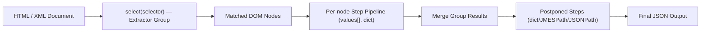

# DSL & Pipeline Steps Reference

The `xsel2` DSL lets you define reusable scraping pipelines in `.dsl` files and run them from `xmlsel-cli`, `xmlsel-pipe`, Python (`scraperpy`), or C++ (`scraper::dsl::DslParser`).

## DSL Syntax

### Comments
Single-line (`#` or `//`) and multi-line (`/* ... */`) comments are supported:

```text
# Hash comment
// Slash comment
/* Multi-line
   comment */
```

### Variables (`let`)
Define reusable strings, numbers, booleans, or lists with `let`:

```text
let title_sel = "h1.product-title"
let keep_keys = ["title", "price"]
```

### Scraper Declarations
A scraper definition binds a name to a chain of `.method(...)` calls. `Scraper()`, `ScraperPy()`, or omitting the constructor are all accepted, and trailing `;` is optional:

```text
product = Scraper()
  .select("h1").text().trim().set("title")
  .select(".price").text().trim().set("price")

# Also valid:
compact: ScraperPy().select("h1").text().set("title");
```

### Grouped Sub-Chains
Use `.( ... )` to visually group related steps in a chain:

```text
page = Scraper()
  .( .select("h1").text().squish().set("title") )
  .( .select(".tag").text().trim().set("tags") )
```

### Literals & Enums
- **Strings**: `"..."` or `'...'` (supports `\n`, `\t`, `\r`, `\\`, `\"`, `\'`, and `${var}` variable interpolation; escape literal `$` with `\${var}`)
- **Numbers**: integers (including negative, e.g. `-1`) and floats (e.g. `1.5`, `-0.25`)
- **Booleans & Null**: `true`, `false`, `null`
- **Lists**: `["a", "b", "c"]`
- **Objects**: `{"old": "new", count: 1}` (string or bare identifier keys)
- **Value enum**: `Value.Text` (`Text`, `text`), `Value.OwnText` (`OwnText`, `own_text`), `Value.Attribute` (`Attribute`, `attr`), `Value.ElementExists` (`ElementExists`, `exists`), `Value.AttributeExists` (`AttributeExists`, `attr_exists`), `Value.Adjacent` (`Adjacent`, `adjacent`)
- **Number enum**: `Number.All` (`All`, `all`), `Number.Last` (`Last`, `last`), `Number.Nth` (`Nth`, `nth`)

### Syntax Sugar
- **Pipe chaining (`|`, `|>`)**: Use `|` or `|>` interchangeably with `.` to chain steps.
- **Paren-free zero-arg steps**: Omit `()` on zero-argument steps (e.g., `text | clean | lower`).
- **Selector shorthand (`$("...")` / `$ "..."`)**: Shorthand for `select("...")` (supports `{ ... }` blocks).
- **Attribute shorthand (`@attr` / `@"attr"`)**: Shorthand for `attr("attr")`.
- **Default shorthand (`?? "val"`)**: Shorthand for `default("val")`.
- **Index shorthand (`[i]` / `[-1]`)**: `[i]` is shorthand for `nth(i)`; `[-1]` is shorthand for `last(1)`.
- **Set shorthands (`->`, `>>`, `as`)**: `-> "key"`, `>> "key"`, or `as "key"` is shorthand for `.set("key")`.
- **Group blocks (`select(...) { ... }` / `$(...) { ... }`)**: Scope steps under a selector using `{ ... }` (leading `.`, `|`, or `|>` on the first step inside `{ ... }` is optional).
- **Keyword arguments**: Pass named arguments to any step, e.g. `json("cfg", allow_comments=true, allow_trailing_comma=true)`.
- **Plain-English aliases**: `strip` (`trim`), `clean` (`squish`), `grep` (`regex_filter`), `extract` (`regex_extract`), `sub` (`regex_replace`), `limit` (`first`), `dedup` (`unique`), `json` (`json_parse`), `to_number` (`parse_number`), `url_join` (`resolve_url`), `inner_html` (`html`).

```text
let tag_sel = ".tag"

product: Scraper()
  | $("h1")       { text | clean as "title" }
  | $("a.docs")   { @href | prepend("https://example.com") -> "manual_url" }
  | $(".price")   { text | extract("([0-9]+\\.[0-9]+)", 1) ?? "0.00" -> "price" }
  | $("body")     { find_all("${tag_sel}", Value.Text) | strip | dedup | limit(5) >> "tags" }
  | $("li.spec")  { text | [0] -> "primary_spec" }
  | merge_patch({"source": "web"})
```

---

## Execution Model

A scraper consists of one or more **Extractor groups**, each started by `.select(selector)` (or `Select()` in C++).



- **Per-node pipeline**: Within a group, steps operate on `values` (`std::vector<std::string>`) and a local `dict` (`jsoncons::json`).
- **Immediate vs. Postponed steps**: Dictionary and query steps (`flatten`, `pick_keys`, `omit_keys`, `rename_keys`, `merge_keys`, `sort_keys`, `deduplicate`, `jmespath`, `jsonpath`) default to `postponable = true`, meaning they run once on the merged output document. Pass `false` (or use `flatten_local()`) to run them immediately on each node's local `dict`.
- **Single vs. Multiple matches**: When an extractor matches one node, its object is merged into the root JSON object; when it matches multiple nodes, results are combined into a JSON array.

---

## Pipeline Steps Reference

> **Naming convention**: Method names below use the DSL / `ScraperPy` `snake_case` names. In C++ `ScraperBuilder`, the corresponding methods use `PascalCase` (e.g., `select` -> `Select`, `squish` -> `Squish`, `regex_extract` -> `RegexExtract`).

### 1. DOM & Selection

| Step | Parameters & Defaults | Description |
| --- | --- | --- |
| `select` | `(selector, key="")` | Starts a new extractor group matching CSS `selector`. Optional `key` scopes output under that key |
| `text` | `(own_text=false)` | Extracts text from the current node (or direct text nodes only if `own_text=true`) into `values` |
| `attr` | `(attr_name)` | Extracts attribute `attr_name` from the current node into `values` |
| `find_all` | `(sel, type, attr="")` | Runs sub-selector `sel` on the current node using `Value` enum `type` (and `attr` for `Attribute` / `AttributeExists`) |
| `find` | `(sel, type, attr="", number=Number.All, nth_val=0)` | Like `find_all`, but selects `All`, `Last`, or `Nth` (`nth_val`) match |
| `html` / `inner_html` | `(outer=false)` | Extracts inner HTML (or outer HTML when `outer=true`) of the current node |
| `outer_html` | `()` | Shorthand for `html(outer=true)` |
| `tag_name` | `()` | Extracts the tag name of the current node |
| `classes` | `()` | Extracts CSS classes of the current node into `values` |
| `attrs` | `(data_only=false)` | Writes all attributes (or only `data-*` attributes when `data_only=true`) into `dict` |

### 2. Text Normalization & Manipulation

| Step | Parameters & Defaults | Description |
| --- | --- | --- |
| `trim` | `()` | Trims leading and trailing whitespace from each value |
| `squish` / `normalize_whitespace` | `()` | Trims and collapses internal whitespace runs to single spaces (`normalize_whitespace` is a DSL/Python alias) |
| `lower` | `()` | Converts each value to lowercase |
| `upper` | `()` | Converts each value to uppercase |
| `unescape` | `(url_decode=true)` | Unescapes HTML entities (and URL `%XX` sequences when `url_decode=true`) |
| `replace` | `(from_str, to_str="")` | Replaces all occurrences of `from_str` with `to_str` |
| `replace_exact` | `(from_str, to_str="")` | Replaces exact-matching values equal to `from_str` with `to_str` |
| `split` | `(delimiter, keep_empty_parts=false)` | Splits each value by `delimiter`, expanding `values` |
| `join` | `(delimiter)` | Joins all `values` into a single string separated by `delimiter` |
| `prepend` | `(prefix_str)` | Prepends `prefix_str` to each value |
| `append` | `(suffix_str)` | Appends `suffix_str` to each value |
| `drop_empty` | `(also_trim=true)` | Drops empty strings (trimming first if `also_trim=true`) |
| `substring` | `(start_pos, length=null)` | Extracts a substring from `start_pos` (supports negative indices) of optional `length` |
| `strip_comments` | `(multiline=true, single_line=true)` | Strips `/* ... */` and/or `// ...` comments from each value |
| `strip_tags` | `()` | Strips HTML/XML tags from strings in `values` |
| `base64_encode` | `(urlsafe=false)` | Base64-encodes each value (`urlsafe=true` uses URL-safe alphabet) |
| `base64_decode` | `(urlsafe=false)` | Base64-decodes each value |
| `hash` | `(algo="fnv1a64")` | Computes deterministic hex digest (`"fnv1a64"` or `"sha256"`) |
| `slugify` | `(separator="-", max_len=null)` | Converts each value to a lowercase URL-friendly slug |

### 2b. URL & Web Normalization

| Step | Parameters & Defaults | Description |
| --- | --- | --- |
| `resolve_url` / `url_join` | `(base_url)` | Resolves relative URLs against `base_url` (RFC 3986 via `libxml2`) |
| `url_part` | `(part)` | Extracts `"scheme"`, `"host"`, `"port"`, `"path"`, `"query"`, or `"fragment"` |
| `query_param` | `(name, default_val="")` | Extracts and URL-decodes query parameter `name` |
| `strip_query` | `(keep_params=[])` | Strips all query parameters (or keeps only `keep_params`) |

### 3. Regex & Filtering (RE2)

| Step | Parameters & Defaults | Description |
| --- | --- | --- |
| `regex_replace` | `(pattern, replacement, flags=null)` | Replaces matches of `pattern` with `replacement`. Optional `flags` string (e.g. `"i"`, `"m"`, `"s"`) |
| `regex_filter` | `(pattern, negate=false, flags=null)` | Keeps values matching `pattern` (or non-matching if `negate=true`) |
| `regex_extract` | `(pattern, group_index=0, flags=null)` | Extracts capture group `group_index` from `pattern` |
| `filter` | `(patterns)` | Keeps values matching any literal pattern in `patterns` (list of strings) |
| `replace_many` | `(mapping)` | Simultaneous single-pass Aho-Corasick replacement using `{old: new, ...}` |
| `extract_many` | `(patterns, unique=true)` | Extracts all matched literal patterns in a single Aho-Corasick pass |

### 4. Slicing & Ordering

| Step | Parameters & Defaults | Description |
| --- | --- | --- |
| `first` | `(count=1)` | Keeps the first `count` items in `values` |
| `last` | `(count=1)` | Keeps the last `count` items in `values` |
| `nth` | `(index)` | Keeps only the item at `index` |
| `slice` | `(start_index, end_index_inclusive)` | Keeps items in `[start_index, end_index_inclusive]` |
| `unique` | `(preserve_order=true)` | Removes duplicate items from `values` |
| `sort` | `(ascending=true, numeric=false)` | Sorts `values` lexicographically (or numerically if `numeric=true`) |
| `reverse` | `()` | Reverses the order of `values` |
| `default` | `(default_value)` | Sets `values` to `[default_value]` if `values` is empty |
| `coalesce` | `(fallback="")` | Drops whitespace-only items, then sets `[fallback]` if empty |

### 5. JS / JSON Block Digger

| Step | Parameters & Defaults | Description |
| --- | --- | --- |
| `js_block` / `extract_js_block` | `(prefix="")` | Locates balanced `{...}` or `[...]` blocks in text (optionally starting after `prefix`; `extract_js_block` is a DSL/Python alias) |
| `js_blocks` / `extract_js_blocks` | `(prefixes)` | Searches for blocks matching any prefix in `prefixes` (list of strings; `extract_js_blocks` is a DSL/Python alias) |
| `parse_js` | `(objname, simplify=true)` | Parses JS/JSON-like text in `values` into structured JSON and stores it under `objname`. When `simplify=true`, concatenates `+`-joined strings and expands `JSON.parse("...")` |

### 6. Dictionary & Query Steps

| Step | Parameters & Defaults | Description |
| --- | --- | --- |
| `set` | `(name, type="string")` | Writes `values` into `dict` under key `name` (supports dot-paths and `type`: `"string"`, `"int"`, `"float"`, `"number"`, `"bool"`, `"auto"`) |
| `append_to` | `(key, allow_empty=false)` | Appends `values` into an array at `dict[key]` |
| `parse_number` / `to_number` | `(decimal=".", thousands=",", allow_float=true, key="")` | Extracts/normalizes numeric strings (e.g. `"$1,299.90"` -> `"1299.90"`); writes native JSON number to `dict[key]` if `key` is set |
| `to_int` / `to_float` / `to_bool` | `(key="", default_val=null)` | Coerces `values` (or writes native JSON int/float/bool to `dict[key]` if `key` is set) |
| `cast_keys` | `(schema, postponable=true)` | Bulk-converts `dict` string fields according to `{key: "int"\|"float"\|"number"\|"bool"\|"auto"}` |
| `zip_keys` | `(keys_key, values_key, target_key="", postponable=true)` | Combines two parallel arrays in `dict` into a JSON object |
| `count` | `(dict_key)` | Writes `len(values)` into `dict` under `dict_key` |
| `flatten` | `(postponable=true)` | Flattens nested objects into dot-separated keys |
| `flatten_local` | `()` | Shorthand for `flatten(false)` |
| `pick_keys` | `(keys_to_keep, postponable=true)` | Keeps only keys listed in `keys_to_keep` |
| `omit_keys` | `(keys_to_remove, postponable=true)` | Removes keys listed in `keys_to_remove` |
| `rename_keys` | `(pairs, postponable=true)` | Renames keys using an even-length list `[old1, new1, old2, new2, ...]` in DSL (or a dict in C++) |
| `merge_keys` | `(source_keys, target_key, postponable=true)` | Combines `source_keys` into `target_key` |
| `sort_keys` | `(ascending=true, postponable=true)` | Sorts object keys alphabetically |
| `deduplicate` | `(postponable=true)` | Removes duplicate elements from JSON arrays |
| `jmespath` | `(expr, postponable=true)` | Transforms the JSON object using a JMESPath expression |
| `jsonpath` | `(expr, postponable=true)` | Queries the JSON object using a JSONPath expression |
| `json_parse` | `(objname="", allow_comments=false, allow_trailing_comma=false, allow_inf_and_nan=false, lossless_number=false, max_nesting_depth=1024, strict=true)` | Parses strict or relaxed JSON in `values` via `jsoncons::json::parse` into `dict` |
| `json_dump` | `(pretty=false, indent=2, source_key="")` | Serializes `dict` (or `dict[source_key]`) to JSON in `values` |
| `csv_parse` | `(objname="", assume_header=true, delimiter=",", trim=true, strict=true)` | Decodes CSV text in `values` into `dict` |
| `csv_dump` | `(assume_header=true, delimiter=",", trim=true, source_key="")` | Encodes `dict` (or `dict[source_key]`) into CSV in `values` |
| `jsonpath_replace` | `(expr, replacement, postponable=true)` | Replaces values matching JSONPath `expr` with `replacement` |
| `json_flatten` | `(postponable=true)` | Flattens JSON into an object keyed by normalized JSONPath strings |
| `json_unflatten` | `(postponable=true)` | Unflattens a JSONPath-flattened object back into nested JSON |
| `jsonpointer_get` | `(pointer, target_key="", postponable=true)` | Extracts value at RFC 6901 JSON Pointer `pointer` |
| `jsonpointer_set` | `(pointer, value, postponable=true)` | Inserts or assigns `value` at RFC 6901 JSON Pointer `pointer` |
| `jsonpointer_remove` | `(pointer, postponable=true)` | Removes value at RFC 6901 JSON Pointer `pointer` |
| `json_patch` | `(patch, postponable=true)` | Applies an RFC 6902 JSON Patch array |
| `merge_patch` | `(patch, postponable=true)` | Applies an RFC 7396 JSON Merge Patch object |
| `json_schema` | `(schema, strict=true, error_key="_schema_errors", postponable=true)` | Validates against a JSON Schema (throws if `strict=true`, or writes `error_key`) |
| `from_cbor` / `to_cbor` | `(objname="", encoding="hex", strict=true)` / `(encoding="hex", source_key="")` | Decodes/encodes CBOR (`hex`, `base64`, or `raw`) |
| `from_msgpack` / `to_msgpack` | `(objname="", encoding="hex", strict=true)` / `(encoding="hex", source_key="")` | Decodes/encodes MessagePack (`hex`, `base64`, or `raw`) |
| `from_bson` / `to_bson` | `(objname="", encoding="hex", strict=true)` / `(encoding="hex", source_key="")` | Decodes/encodes BSON (`hex`, `base64`, or `raw`) |
| `from_ubjson` / `to_ubjson` | `(objname="", encoding="hex", strict=true)` / `(encoding="hex", source_key="")` | Decodes/encodes UBJSON (`hex`, `base64`, or `raw`) |

### 7. Debugging

| Step | Parameters & Defaults | Description |
| --- | --- | --- |
| `debug` | `(prefix="DEBUG: ", print_dict=false, print_node=false)` | Prints current `values` (and optionally `dict` and DOM `node`) to `stderr` |
